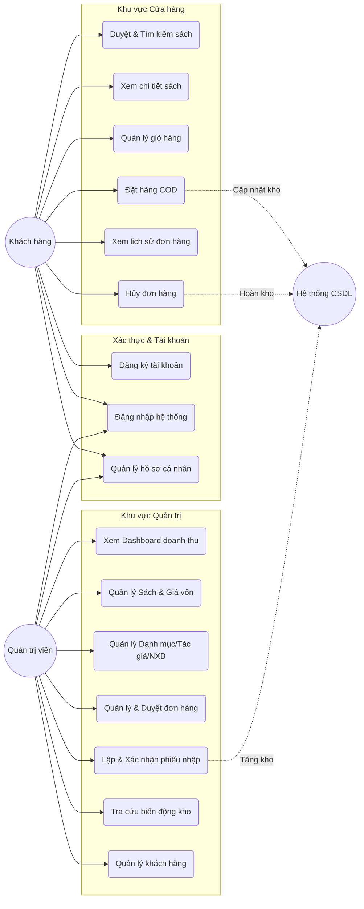
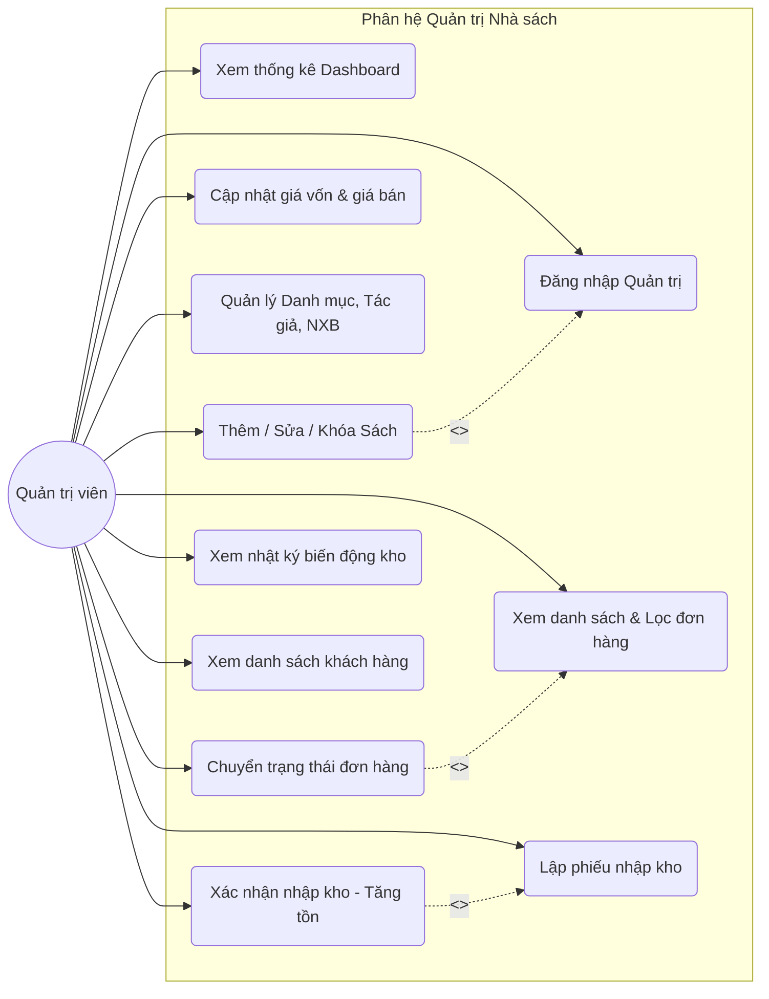
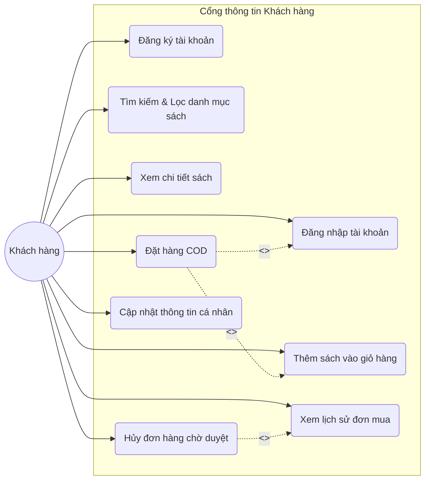
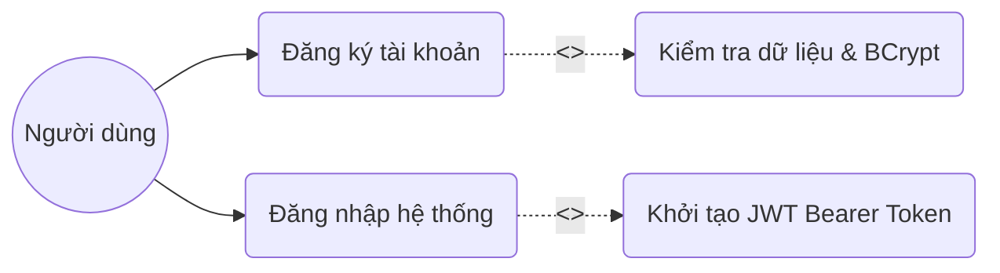
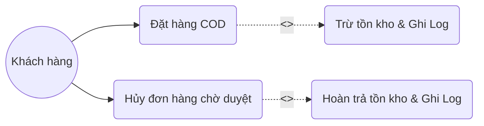
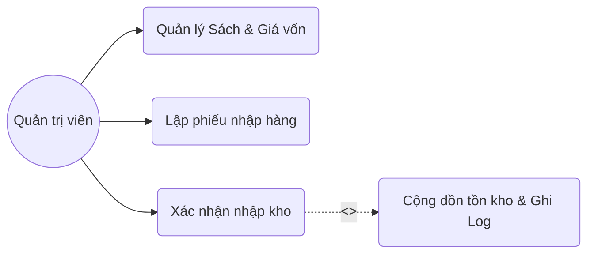
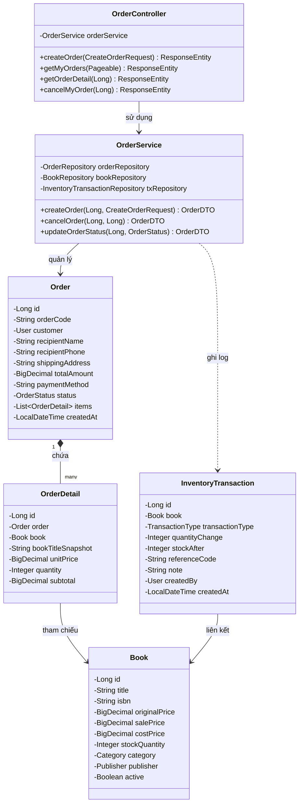
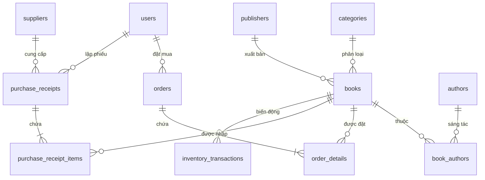

# BÁO CÁO ĐỒ ÁN MÔN HỌC

**ĐỀ TÀI:**
# XÂY DỰNG WEBSITE QUẢN LÝ VÀ KINH DOANH SÁCH TRỰC TUYẾN (BOOKSTORE MANAGEMENT SYSTEM)

---

> ### HƯỚNG DẪN ĐỊNH DẠNG VĂN BẢN (KHI CHUYỂN SANG MICROSOFT WORD)
> - **Font chữ:** Times New Roman, cỡ chữ 13 hoặc 14; mật độ chữ bình thường, không nén/kéo dãn.
> - **Chế độ giãn dòng:** 1.5 lines; Spacing: Before 6 pt, After 6 pt.
> - **Căn lề (Margins):** Lề trên: 3.0 cm; Lề dưới: 3.0 cm; Lề trái: 3.5 cm; Lề phải: 2.0 cm.
> - **Đánh số trang:** Đánh ở phía trên đầu mỗi trang giấy, căn lề phải (Header - Right).
> - **Quy định về Bảng (Table):**
>   - Đánh số theo Chương: *Bảng 1.1*, *Bảng 2.1*, *Bảng 2.2*...
>   - Bảng căn giữa trang. Tiêu đề đặt **ở trên** bảng, căn giữa, cách trên và dưới 12 pt, font Times New Roman cỡ chữ 12 (*Tiêu đề in nghiêng*, tên bảng viết in thường).
>   - Chữ và số trong bảng: Font Times New Roman cỡ chữ 12, Before 4 pt, After 4 pt.
> - **Quy định về Hình (Figure):**
>   - Đánh số theo Chương: *Hình 1.1*, *Hình 2.1*, *Hình 3.1*...
>   - Hình căn giữa trang. Tiêu đề đặt **ở dưới** hình, căn giữa, font Times New Roman cỡ chữ 12 (*Tiêu đề in nghiêng*, tên hình viết in thường).
>   - Các vị trí có ghi chú `[HÌNH X.X: ...]` hoặc `[ẢNH MINH HỌA - BẠN CHỤP ẢNH TỪ SẢN PHẨM...]` là các vị trí chính xác để bạn chụp màn hình thực tế từ hệ thống đang chạy hoặc vẽ lại từ mã Mermaid/PlantUML được cung cấp sẵn.

---

\newpage

## LỜI CẢM ƠN

Trong quá trình học tập, nghiên cứu và hoàn thành đồ án môn học này, em đã nhận được sự quan tâm, chỉ dẫn tận tình từ các thầy cô giáo bộ môn cùng sự hỗ trợ, động viên từ gia đình và bạn bè.

Lời đầu tiên, em xin bày tỏ lòng biết ơn sâu sắc đến quý Thầy/Cô trong Khoa Công nghệ Thông tin đã truyền đạt cho em những kiến thức nền tảng quý báu về kỹ thuật lập trình, phân tích thiết kế hệ thống, cơ sở dữ liệu và kiến trúc phần mềm trong suốt quá trình học tập.

Đặc biệt, em xin gửi lời cảm ơn chân thành nhất đến Thầy/Cô hướng dẫn môn học, người đã luôn định hướng, tận tình chỉ dẫn và đóng góp những ý kiến chuyên môn sâu sắc giúp em hoàn thiện đồ án này một cách đúng đắn và chuẩn mực nhất.

Mặc dù em đã nỗ lực hết mình để xây dựng hệ thống và trình bày báo cáo một cách hoàn chỉnh nhất, song do thời gian và kinh nghiệm thực tế còn hạn chế, đồ án chắc chắn khó tránh khỏi những thiếu sót nhất định. Em rất mong nhận được những lời nhận xét, góp ý quý báu từ quý Thầy/Cô để đồ án được hoàn thiện hơn nữa và giúp em tích lũy thêm nhiều kinh nghiệm thực tiễn cho các đề tài tiếp theo.

*Em xin chân thành cảm ơn!*

---

\newpage

## MỤC LỤC

- **LỜI CẢM ƠN**
- **DANH MỤC CÁC CHỮ VIẾT TẮT**
- **DANH MỤC CÁC BẢNG**
- **DANH MỤC CÁC HÌNH**
- **MỞ ĐẦU**
  - 1. Lý do chọn đề tài
  - 2. Mục tiêu nghiên cứu và phát triển
  - 3. Đối tượng và phạm vi nghiên cứu
  - 4. Phương pháp nghiên cứu
  - 5. Nội dung chính của đồ án
- **CHƯƠNG 1: TỔNG QUAN VỀ CÔNG NGHỆ VÀ CÔNG CỤ XÂY DỰNG HỆ THỐNG**
  - 1.1 Ngôn ngữ và nền tảng Backend (Java 21 LTS, Spring Boot 3.3)
  - 1.2 Cơ chế xác thực và bảo mật (Spring Security 6, JJWT, BCrypt)
  - 1.3 Hệ quản trị cơ sở dữ liệu và quản trị migration (MySQL 8.0, Flyway)
  - 1.4 Công nghệ Frontend (React 19, TypeScript, Vite)
  - 1.5 Thiết kế giao diện và trải nghiệm người dùng (Vanilla CSS Design System)
  - 1.6 Môi trường và công cụ phát triển phần mềm
- **CHƯƠNG 2: PHÂN TÍCH VÀ THIẾT KẾ HỆ THỐNG**
  - 2.1 Mô tả bài toán
  - 2.2 Yêu cầu bài toán
    - 2.2.1 Yêu cầu chức năng
    - 2.2.2 Yêu cầu phi chức năng
  - 2.4 Biểu đồ Use Case
    - 2.4.1 Biểu đồ Use Case tổng quát
    - 2.4.2 Biểu đồ Use Case phân hệ Quản trị (Admin)
    - 2.4.3 Biểu đồ Use Case phân hệ Khách hàng (User)
  - 2.5 Mô tả chi tiết các Use Case trọng tâm
    - 2.5.1 Use case Đăng ký tài khoản (UC_Register)
    - 2.5.2 Use case Đăng nhập hệ thống (UC_Login)
    - 2.5.3 Use case Duyệt và tìm kiếm sách (UC_SearchBooks)
    - 2.5.4 Use case Đặt hàng thanh toán khi nhận hàng (UC_CheckoutCOD)
    - 2.5.5 Use case Khách hàng hủy đơn hàng (UC_CancelOrder)
    - 2.5.6 Use case Quản lý sách và giá vốn (UC_ManageBooks)
    - 2.5.7 Use case Quản trị quy trình đơn hàng (UC_ManageOrders)
    - 2.5.8 Use case Lập và xác nhận phiếu nhập hàng (UC_PurchaseReceipt)
    - 2.5.9 Use case Xem báo cáo Dashboard doanh thu (UC_ViewDashboard)
  - 2.6 Thiết kế Backend
    - 2.6.1 Thiết kế biểu đồ mô tả các chức năng (Biểu đồ trình tự - Sequence Diagrams)
      - 2.6.1.1 Chức năng Xác thực người dùng (Login JWT)
      - 2.6.1.2 Chức năng Đặt hàng COD và trừ tồn kho
      - 2.6.1.3 Chức năng Hủy đơn hàng và hoàn trả tồn kho an toàn
      - 2.6.1.4 Chức năng Xác nhận phiếu nhập và tăng tồn kho
    - 2.6.2 Biểu đồ lớp tổng thể (VOPC - View of Participating Classes)
    - 2.6.3 Thiết kế Cơ sở dữ liệu chi tiết
- **CHƯƠNG 3: CHƯƠNG TRÌNH THỬ NGHIỆM VÀ KẾT QUẢ**
  - 3.1 Môi trường triển khai thử nghiệm
  - 3.2 Giao diện và mô tả chương trình hoàn thiện
    - 3.2.1 Giao diện phân hệ Khách hàng
    - 3.2.2 Giao diện phân hệ Quản trị (Admin)
  - 3.3 Kiểm thử chức năng hệ thống (Test Cases)
    - 3.3.1 Kịch bản kiểm thử luồng Đặt hàng và xử lý kho
    - 3.3.2 Kịch bản kiểm thử luồng Hủy đơn hàng và hoàn kho
    - 3.3.3 Bảng tổng hợp kết quả kiểm thử chức năng
- **KẾT LUẬN VÀ HƯỚNG PHÁT TRIỂN**
- **TÀI LIỆU THAM KHẢO**

---

\newpage

## DANH MỤC CÁC CHỮ VIẾT TẮT

*Bảng 0.1. Danh mục các chữ viết tắt sử dụng trong đồ án*

| Chữ viết tắt | Từ tiếng Anh nguyên gốc | Ý nghĩa tiếng Việt |
| :--- | :--- | :--- |
| **API** | Application Programming Interface | Giao diện lập trình ứng dụng |
| **BCrypt** | Blowfish Cryptographic Hash Function | Thuật toán băm mật khẩu một chiều có salt |
| **COD** | Cash On Delivery | Phương thức thanh toán tiền mặt khi giao nhận hàng |
| **CORS** | Cross-Origin Resource Sharing | Cơ chế chia sẻ tài nguyên giữa các nguồn khác nhau |
| **CRUD** | Create, Read, Update, Delete | Bốn thao tác cơ bản trên dữ liệu: Tạo, Đọc, Sửa, Xóa |
| **CSRF** | Cross-Site Request Forgery | Tấn công giả mạo yêu cầu từ trang chéo |
| **DTO** | Data Transfer Object | Đối tượng truyền tải dữ liệu giữa các tầng kiến trúc |
| **E2E** | End to End | Kiểm thử tích hợp toàn diện từ đầu cuối đến cơ sở dữ liệu |
| **HTTP/HTTPS**| HyperText Transfer Protocol / Secure | Giao thức truyền tải siêu văn bản an toàn |
| **ISBN** | International Standard Book Number | Mã số tiêu chuẩn quốc tế cho sách |
| **JPA** | Jakarta Persistence API | Chuẩn đặc tả ánh xạ đối tượng quan hệ (ORM) trong Java |
| **JSON** | JavaScript Object Notation | Định dạng trao đổi dữ liệu dạng chuỗi ký tự |
| **JWT** | JSON Web Token | Chuẩn mã hóa token định danh trạng thái xác thực người dùng |
| **MVP** | Minimum Viable Product | Sản phẩm khả dụng tối thiểu đáp ứng nghiệp vụ lõi |
| **ORM** | Object-Relational Mapping | Kỹ thuật ánh xạ giữa đối tượng hướng đối tượng và CSDL quan hệ |
| **REST** | Representational State Transfer | Phong cách kiến trúc hướng tài nguyên cho dịch vụ web |
| **SPA** | Single Page Application | Ứng dụng web một trang tải động |
| **SQL** | Structured Query Language | Ngôn ngữ truy vấn dữ liệu có cấu trúc |
| **UI/UX** | User Interface / User Experience | Giao diện người dùng / Trải nghiệm người dùng |
| **VOPC** | View of Participating Classes | Biểu đồ các lớp thành phần tham gia thực thi use case |

---

\newpage

## DANH MỤC CÁC BẢNG

- *Bảng 0.1:* Danh mục các chữ viết tắt sử dụng trong đồ án
- *Bảng 2.1:* Mô tả chi tiết use case Đăng ký tài khoản (UC_Register)
- *Bảng 2.2:* Mô tả chi tiết use case Đăng nhập hệ thống (UC_Login)
- *Bảng 2.3:* Mô tả chi tiết use case Duyệt và tìm kiếm sách (UC_SearchBooks)
- *Bảng 2.4:* Mô tả chi tiết use case Đặt hàng COD (UC_CheckoutCOD)
- *Bảng 2.5:* Mô tả chi tiết use case Khách hàng hủy đơn hàng (UC_CancelOrder)
- *Bảng 2.6:* Mô tả chi tiết use case Quản lý sách và giá vốn (UC_ManageBooks)
- *Bảng 2.7:* Mô tả chi tiết use case Quản lý đơn hàng (UC_ManageOrders)
- *Bảng 2.8:* Mô tả chi tiết use case Lập và xác nhận phiếu nhập hàng (UC_PurchaseReceipt)
- *Bảng 2.9:* Mô tả chi tiết use case Xem báo cáo Dashboard (UC_ViewDashboard)
- *Bảng 2.10:* Đặc tả cấu trúc bảng người dùng (`users`)
- *Bảng 2.11:* Đặc tả cấu trúc bảng danh mục sách (`categories`)
- *Bảng 2.12:* Đặc tả cấu trúc bảng tác giả (`authors`)
- *Bảng 2.13:* Đặc tả cấu trúc bảng nhà xuất bản (`publishers`)
- *Bảng 2.14:* Đặc tả cấu trúc bảng sách (`books`)
- *Bảng 2.15:* Đặc tả cấu trúc bảng nhà cung cấp (`suppliers`)
- *Bảng 2.16:* Đặc tả cấu trúc bảng phiếu nhập hàng (`purchase_receipts`)
- *Bảng 2.17:* Đặc tả cấu trúc bảng chi tiết phiếu nhập (`purchase_receipt_items`)
- *Bảng 2.18:* Đặc tả cấu trúc bảng đơn hàng (`orders`)
- *Bảng 2.19:* Đặc tả cấu trúc bảng chi tiết đơn hàng snapshot (`order_details`)
- *Bảng 2.20:* Đặc tả cấu trúc bảng lịch sử biến động kho (`inventory_transactions`)
- *Bảng 3.1:* Bảng tổng hợp kịch bản kiểm thử chức năng hệ thống

---

\newpage

## DANH MỤC CÁC HÌNH

- *Hình 2.1:* Biểu đồ Use Case tổng quát toàn hệ thống
- *Hình 2.2:* Biểu đồ Use Case phân hệ Quản trị viên (Admin)
- *Hình 2.3:* Biểu đồ Use Case phân hệ Khách hàng (User)
- *Hình 2.4:* Mô hình hóa Use Case Đăng ký và Đăng nhập
- *Hình 2.5:* Mô hình hóa Use Case Đặt hàng COD và Hủy đơn hàng
- *Hình 2.6:* Mô hình hóa Use Case Quản lý sách và Nhập hàng
- *Hình 2.7:* Biểu đồ trình tự chức năng Đăng nhập hệ thống (JWT Authentication)
- *Hình 2.8:* Biểu đồ trình tự chức năng Đặt hàng COD và Trừ tồn kho
- *Hình 2.9:* Biểu đồ trình tự chức năng Hủy đơn hàng và Hoàn kho
- *Hình 2.10:* Biểu đồ trình tự chức năng Xác nhận phiếu nhập và Tăng tồn kho
- *Hình 2.11:* Biểu đồ lớp phân tích (VOPC) phân hệ Đơn hàng và Kho sách
- *Hình 2.12:* Biểu đồ mối quan hệ thực thể (ERD) cơ sở dữ liệu
- *Hình 3.1:* Giao diện Trang chủ và Danh mục sách nổi bật
- *Hình 3.2:* Giao diện Tìm kiếm, Lọc sách theo giá và danh mục
- *Hình 3.3:* Giao diện Trang chi tiết sách và chức năng Thêm vào giỏ
- *Hình 3.4:* Giao diện Giỏ hàng và tính toán tổng tiền
- *Hình 3.5:* Giao diện Thanh toán đơn hàng COD
- *Hình 3.6:* Giao diện Quản lý Đơn hàng của tôi và chức năng Hủy đơn
- *Hình 3.7:* Giao diện Đăng nhập hệ thống với phím tắt tài khoản Demo
- *Hình 3.8:* Giao diện Bảng điều khiển Quản trị (Admin Dashboard)
- *Hình 3.9:* Giao diện Quản lý danh mục sách
- *Hình 3.10:* Giao diện Quản lý kho sách và cập nhật giá vốn
- *Hình 3.11:* Giao diện Quản lý đơn hàng và điều chuyển trạng thái
- *Hình 3.12:* Giao diện Lập phiếu nhập và Xác nhận nhập kho
- *Hình 3.13:* Giao diện Tra cứu lịch sử biến động kho (Audit Log)
- *Hình 3.14:* Kết quả chạy kiểm thử tự động Backend (JUnit Test Suite)
- *Hình 3.15:* Kết quả thực thi kịch bản kiểm thử tích hợp E2E

---

\newpage

## MỞ ĐẦU

### 1. Lý do chọn đề tài
Trong kỷ nguyên chuyển đổi số và sự bùng nổ của thương mại điện tử, thói quen tiếp cận tri thức và văn hóa đọc của người dân đã có những bước chuyển biến mạnh mẽ. Thay vì việc trực tiếp đến các nhà sách truyền thống gặp nhiều rào cản về thời gian, khoảng cách địa lý và khó khăn trong việc tra cứu đầu sách, người độc giả ngày nay có xu hướng tìm kiếm, tham khảo đánh giá và đặt mua sách trực tuyến thông qua các nền tảng số.

Về phía các đơn vị kinh doanh xuất bản phẩm, phương thức quản lý thủ công bằng sổ sách hoặc phần mềm bảng tính rời rạc bộc lộ nhiều hạn chế nghiêm trọng: thất thoát tồn kho, dữ liệu doanh thu thiếu chính xác, sai lệch giá vốn, quy trình xử lý đơn hàng chậm trễ và không có cơ chế lưu vết lịch sử biến động kho.

Xuất phát từ thực tiễn trên, đồ án môn học lựa chọn đề tài: **"Xây dựng Website Quản lý và Kinh doanh Sách trực tuyến"**. Đề tài không chỉ giải quyết trọn vẹn bài toán thương mại điện tử hướng tới người mua sách với trải nghiệm mượt mà, trực quan, mà còn cung cấp một công cụ quản trị tinh gọn, chuẩn mực với đầy đủ quy trình quản lý danh mục, sách, đơn hàng, nhập kho và kiểm soát biến động tồn kho theo thời gian thực.

### 2. Mục tiêu nghiên cứu và phát triển
- **Về mặt học thuật:** Vận dụng toàn diện kiến thức chuyên ngành về kỹ thuật phân tích thiết kế hệ thống hướng đối tượng (OOAD), kiến trúc phân tầng (Layered Architecture), xây dựng RESTful API theo chuẩn với Spring Boot, thiết kế cơ sở dữ liệu quan hệ chuẩn hóa (3NF) với MySQL, và xây dựng giao diện ứng dụng Single Page Application (SPA) hiện đại với React và TypeScript.
- **Về mặt kỹ thuật thực tiễn:**
  - Xây dựng hệ thống vận hành hoàn chỉnh trên môi trường máy tính cục bộ (Local Development), đảm bảo tính khép kín, an toàn, không phụ thuộc vào hạ tầng cloud tốn kém.
  - Thiết kế cơ chế xác thực phân quyền nghiêm ngặt giữa vai trò Quản trị viên (`ROLE_ADMIN`) và Khách hàng (`ROLE_CUSTOMER`) thông qua JWT Bearer Token kết hợp bộ lọc bảo mật Spring Security 6.
  - Hiện thực hóa quy trình giao dịch đặt hàng và hủy đơn hàng với cơ chế quản lý giao dịch `@Transactional`, đảm bảo tính toàn vẹn dữ liệu (ACID), tự động trừ/hoàn kho và lưu vết kiểm toán (Audit Trail) chính xác.
  - Đảm bảo tính bảo mật dữ liệu kinh doanh: Tuyệt đối không để lộ giá vốn (`cost_price`) và thông tin mã hóa nhạy cảm ra các endpoint công khai.

### 3. Đối tượng và phạm vi nghiên cứu
- **Đối tượng nghiên cứu:** Quy trình nghiệp vụ bán hàng, quản lý đơn hàng COD, quy trình nhập kho từ nhà cung cấp và quản lý biến động tồn kho xuất bản phẩm.
- **Phạm vi đồ án:**
  - Hệ thống phần mềm hoàn chỉnh gồm 2 phân hệ: Phân hệ Cửa hàng cho khách hàng (Storefront) và Phân hệ Quản trị (Admin Portal).
  - Triển khai và chạy thử nghiệm trực tiếp trên môi trường máy tính cục bộ (Localhost).
  - Nghiệp vụ thanh toán tập trung vào hình thức Thanh toán tiền mặt khi nhận hàng (COD), mô phỏng đầy đủ quy trình xác nhận, giao hàng và hoàn tất.

### 4. Phương pháp nghiên cứu
- Phương pháp phân tích và thiết kế hướng đối tượng: Sử dụng ngôn ngữ mô hình hóa thống nhất UML (Use Case Diagram, Sequence Diagram, Class Diagram).
- Phương pháp phát triển phần mềm lặp và gia tăng (Iterative & Incremental): Chia nhỏ các giai đoạn phát triển từ thiết kế CSDL, xây dựng API lõi đến ghép nối giao diện và kiểm thử E2E.
- Phương pháp kiểm thử phần mềm: Áp dụng Unit Test, Integration Test với Spring Boot Test / MockMvc và kiểm thử tích hợp tự động qua kịch bản PowerShell REST Client.

### 5. Nội dung chính của đồ án
Báo cáo đồ án được kết cấu thành 3 chương chính:
- **Chương 1: Tổng quan về công nghệ và công cụ xây dựng hệ thống:** Trình bày chi tiết các công nghệ nền tảng bao gồm Java 21 LTS, Spring Boot 3, Spring Security, MySQL 8, React, TypeScript và các công cụ phát triển.
- **Chương 2: Phân tích và thiết kế hệ thống:** Mô tả bài toán, đặc tả yêu cầu chức năng, yêu cầu phi chức năng, hệ thống biểu đồ Use Case, mô tả chi tiết các Use Case, biểu đồ trình tự, biểu đồ lớp tổng thể và thiết kế CSDL chi tiết 12 bảng chuẩn hóa.
- **Chương 3: Chương trình thử nghiệm và kết quả:** Mô tả các màn hình giao diện thực tế của hệ thống, hướng dẫn vị trí chèn ảnh chụp từ sản phẩm thực tế, bảng ca kiểm thử và đánh giá kết quả nghiệm thu.

---

\newpage

# CHƯƠNG 1: TỔNG QUAN VỀ CÔNG NGHỆ VÀ CÔNG CỤ XÂY DỰNG HỆ THỐNG

### 1.1 Ngôn ngữ và nền tảng Backend (Java 21 LTS, Spring Boot 3.3)
Phần mềm phía máy chủ (Backend) được xây dựng dựa trên hệ sinh thái Java Enterprise hiện đại:
- **Java 21 LTS:** Phiên bản hỗ trợ dài hạn mới nhất của ngôn ngữ Java, cung cấp hiệu năng tối ưu, tính năng Pattern Matching nâng cao, quản lý bộ nhớ vượt trội và khả năng tương thích cao với các tiêu chuẩn công nghiệp.
- **Spring Boot 3.3.4:** Framework mã nguồn mở hàng đầu cho phát triển ứng dụng doanh nghiệp. Spring Boot cung cấp cơ chế cấu hình tự động (Auto-configuration), nhúng sẵn máy chủ web Apache Tomcat, tích hợp cơ chế Dependency Injection (DI) và Inversion of Control (IoC), giúp mã nguồn module hóa, dễ dàng mở rộng và bảo trì.
- **Spring Data JPA & Hibernate:** Đơn giản hóa tầng truy cập dữ liệu (Data Access Layer). Hibernate đóng vai trò là JPA Provider, tự động ánh xạ giữa các lớp Java Entity và bảng dữ liệu quan hệ trong MySQL, giảm thiểu tối đa việc viết câu lệnh SQL thủ công và phòng chống hoàn toàn các lỗ hổng SQL Injection.
- **Jakarta Bean Validation:** Áp dụng các annotation kiểm tra dữ liệu đầu vào (`@NotNull`, `@NotBlank`, `@Size`, `@Email`, `@Min`) ngay tại tầng DTO, đảm bảo dữ liệu hợp lệ trước khi đi vào tầng xử lý nghiệp vụ.

### 1.2 Cơ chế xác thực và bảo mật (Spring Security 6, JJWT, BCrypt)
Bảo mật hệ thống là yếu tố sống còn đối với ứng dụng thương mại điện tử. Hệ thống triển khai giải pháp bảo mật phi trạng thái (Stateless Security):
- **Spring Security 6:** Quản lý luồng lọc yêu cầu (Filter Chain), ngăn chặn tấn công giả mạo yêu cầu từ trang chéo (CSRF) bằng kiến trúc Stateless Session, cấu hình CORS linh hoạt cho phép gọi API an toàn từ máy chủ Frontend.
- **JJWT (io.jsonwebtoken 0.12.6):** Thư viện tạo và xác minh JSON Web Token. Khi người dùng đăng nhập thành công, hệ thống mã hóa định danh người dùng và danh sách quyền hạn (Roles) vào một JWT Bearer Token có chữ ký số bí mật (Secret Key HMAC-SHA256) và thời hạn sống xác định. Mọi request tiếp theo gửi kèm token trong HTTP Header `Authorization: Bearer <token>` sẽ được bộ lọc `JwtAuthenticationFilter` giải mã và nạp thông tin vào `SecurityContextHolder`.
- **BCrypt Password Encoder:** Toàn bộ mật khẩu của người dùng và quản trị viên được băm bằng thuật toán BCrypt với Salt ngẫu nhiên có độ dài 10 rounds trước khi lưu trữ vào CSDL. Mật khẩu dạng văn bản thuần (plain text) tuyệt đối không bao giờ được ghi vào database hay xuất hiện trong log hệ thống.

### 1.3 Hệ quản trị cơ sở dữ liệu và quản trị migration (MySQL 8.0, Flyway)
- **MySQL 8.0:** Hệ quản trị cơ sở dữ liệu quan hệ phổ biến, tin cậy, hỗ trợ giao thức ACID toàn diện, chỉ mục hiệu năng cao, tối ưu hóa các phép nối (JOIN) phức tạp giữa các bảng dữ liệu đơn hàng và tồn kho.
- **Flyway Community Edition:** Công cụ quản trị phiên bản cơ sở dữ liệu tự động. Mọi thay đổi về cấu trúc bảng và dữ liệu khởi tạo được quản lý qua các file SQL có định danh phiên bản (`V1__init_schema.sql`, `V2__seed_initial_data.sql`). Khi backend khởi động, Flyway tự động so khớp và thực thi các tệp di trú, đảm bảo môi trường phát triển luôn đồng bộ dữ liệu tuyệt đối giữa các thành viên.

### 1.4 Công nghệ Frontend (React 19, TypeScript, Vite)
Giao diện người dùng được xây dựng theo mô hình Single Page Application (SPA):
- **React 19:** Thư viện JavaScript hàng đầu của Meta trong việc xây dựng giao diện người dùng dựa trên các thành phần (Component-based). Khả năng tái sử dụng component cao, quản lý trạng thái mượt mà thông qua React Hooks (`useState`, `useEffect`, `useContext`, `useMemo`).
- **TypeScript:** Ngôn ngữ mở rộng của JavaScript bổ sung hệ thống kiểu tĩnh (Static Typing). Giúp phát hiện lỗi cú pháp và sai lệch kiểu dữ liệu ngay trong quá trình biên dịch (Compile-time), mang lại sự tin cậy cao và cấu trúc code chặt chẽ.
- **Vite 6:** Công cụ đóng gói (Bundler) thế hệ mới sử dụng cơ chế Native ES Modules và trình biên dịch esbuild viết bằng Go. Tốc độ khởi động máy chủ phát triển (Dev Server) chỉ mất chưa đầy 300ms và cơ chế Hot Module Replacement (HMR) cực nhanh.
- **Axios Client:** Thư viện HTTP client mạnh mẽ hỗ trợ thiết lập `AxiosInterceptor`. Hệ thống tự động đính kèm JWT token vào header của mọi request đi ra và xử lý tập trung lỗi xác thực (mã lỗi 401/403) để tự động điều hướng về trang đăng nhập.
- **Lucide React:** Bộ thư viện icon vector mã nguồn mở hiện đại, sắc nét và nhẹ, nâng cao tính trực quan cho các nút chức năng và thanh điều hướng.

### 1.5 Thiết kế giao diện và trải nghiệm người dùng (Vanilla CSS Design System)
Nhằm đảm bảo tính linh hoạt tối đa, hiệu năng cao và loại bỏ sự cồng kềnh của các CSS framework nặng nề, đồ án tự xây dựng hệ thống thiết kế (Design System) bằng **Vanilla CSS thuần**:
- **Bảng màu (Color Palette):** Phối hợp hài hòa giữa sắc xanh chàm hoàng gia (Primary Indigo: `#4f46e5`, `#4338ca`) tượng trưng cho sự tin cậy và tri thức, kết hợp cùng sắc xanh lục bảo (Emerald: `#10b981`) thể hiện sự thành công của giao dịch đặt hàng và dòng tiền.
- **Typography:** Ứng dụng phông chữ hiện đại Google Font **Plus Jakarta Sans**, tối ưu hóa khả năng đọc trên màn hình điện tử, hỗ trợ hiển thị hoàn hảo dấu tiếng Việt.
- **Hiệu ứng thị giác:** Sử dụng kỹ thuật Glassmorphism (lớp kính mờ), bóng đổ đa tầng (box-shadow đa lớp), bo góc hiện đại (border-radius: 12px - 16px), chuyển động vi mô (Micro-animations) mượt mà khi di chuột và tương tác nút.
- **Thiết kế thích ứng (Responsive Web Design):** Sử dụng linh hoạt CSS Flexbox và CSS Grid Layout, đảm bảo giao diện hiển thị tối ưu trên cả màn hình máy tính bàn, máy tính bảng và điện thoại di động.

### 1.6 Môi trường và công cụ phát triển phần mềm
- **Hệ điều hành:** Microsoft Windows 11 x64.
- **Môi trường phát triển tích hợp (IDE):** Antigravity IDE, Visual Studio Code và IntelliJ IDEA.
- **Trình biên dịch & thực thi:** OpenJDK 21.0.12 LTS, Node.js v24 LTS, npm 11.
- **Công cụ kiểm thử API:** Postman, cURL và PowerShell REST Scripts tự động.

---

\newpage

# CHƯƠNG 2: PHÂN TÍCH VÀ THIẾT KẾ HỆ THỐNG

### 2.1 Mô tả bài toán
Một nhà sách mong muốn xây dựng hệ thống website thương mại điện tử nhằm chuyển đổi số mô hình kinh doanh truyền thống. Hệ thống phải phục vụ hai nhóm đối tượng tác nhân chính:
1. **Khách hàng (Customer):** Những người có nhu cầu tìm kiếm, tham khảo, đặt mua sách và theo dõi tình trạng đơn hàng từ xa một cách nhanh chóng.
2. **Quản trị viên / Nhân viên nhà sách (Admin):** Người chịu trách nhiệm vận hành cửa hàng, quản lý danh mục đầu sách, cập nhật thông tin giá bán và giá vốn nhập hàng, theo dõi đơn đặt hàng, thực hiện các thao tác xác nhận đơn, điều phối giao hàng, lập phiếu nhập kho khi có sách về từ các nhà cung cấp và theo dõi số liệu doanh thu.

Quy trình kinh doanh đòi hỏi sự chặt chẽ: Khi khách hàng đặt mua sách, hệ thống phải kiểm tra lượng tồn kho thực tế, tính toán lại tổng tiền từ giá niêm yết trong cơ sở dữ liệu để phòng chống việc người dùng can thiệp sửa giá từ trình duyệt, tiến hành trừ tồn kho và ghi nhật ký biến động kho tương ứng. Nếu khách hàng hủy đơn hàng khi đơn chưa được xử lý, số lượng sách phải được hoàn trả lại kho tự động và ghi nhật ký hoàn kho tương ứng. Khi nhập hàng, chỉ khi quản trị viên ấn nút Xác nhận phiếu nhập thì lượng tồn kho của các đầu sách mới được cộng dồn chính xác.

---

### 2.2 Yêu cầu bài toán

#### 2.2.1 Yêu cầu chức năng
Hệ thống được chia thành 3 nhóm phân hệ chức năng chính:

**A. Phân hệ Tài khoản và Xác thực (Authentication & Authorization):**
- Đăng ký tài khoản khách hàng mới với đầy đủ thông tin hợp lệ (Họ tên, email, mật khẩu, số điện thoại, địa chỉ giao hàng).
- Đăng nhập hệ thống cấp phát JWT Token.
- Xem thông tin hồ sơ cá nhân và cập nhật thông tin, thay đổi mật khẩu.
- Phân quyền nghiêm ngặt: Khách hàng chỉ được xem và thao tác trên dữ liệu của chính mình; Quản trị viên được phép truy cập khu vực `/admin`.

**B. Phân hệ Cửa hàng dành cho Khách hàng (Storefront):**
- Hiển thị danh sách sách mở bán kèm ảnh bìa, tên sách, tác giả, nhà xuất bản, danh mục, giá niêm yết, tình trạng tồn kho. Tuyệt đối không hiển thị giá vốn nhập hàng (`cost_price`).
- Lọc sách theo danh mục, khoảng giá, sắp xếp theo tên hoặc giá.
- Tìm kiếm sách theo từ khóa trong tiêu đề, mô tả hoặc tác giả.
- Xem chi tiết từng cuốn sách.
- Quản lý giỏ hàng: Thêm sách, cập nhật số lượng mua, xóa từng mục hoặc xóa toàn bộ giỏ hàng (lưu trữ đồng bộ trên LocalStorage).
- Đặt hàng thanh toán khi nhận hàng (COD): Nhập thông tin người nhận, địa chỉ giao hàng, ghi chú.
- Xem lịch sử đơn hàng của tôi và xem chi tiết tiến trình từng đơn hàng.
- Hủy đơn hàng khi đơn hàng đang ở trạng thái Chờ xử lý (`PENDING`).

**C. Phân hệ Quản trị cửa hàng và Kho (Admin Portal):**
- Bảng điều khiển (Dashboard) thống kê thời gian thực: Tổng doanh thu, tổng số đơn hàng đã hoàn tất, tổng số khách hàng đăng ký, tổng số đầu sách và danh sách cảnh báo các sách sắp hết hàng (tồn kho dưới mức an toàn).
- Quản lý danh mục sách (Categories): Thêm mới, chỉnh sửa tên/mô tả, đổi trạng thái hoạt động.
- Quản lý tác giả (Authors) và Nhà xuất bản (Publishers).
- Quản lý sách (Books): Thêm sách mới, sửa thông tin, cập nhật ảnh bìa, giá bán, giá vốn bí mật, trạng thái mở bán/ngừng bán.
- Quản lý đơn hàng (Orders): Xem danh sách đơn hàng, lọc theo trạng thái (`PENDING`, `CONFIRMED`, `SHIPPING`, `COMPLETED`, `CANCELLED`), cập nhật trạng thái đơn theo quy trình xử lý thực tế.
- Quản lý nhập kho (Purchase Receipts): Lập phiếu nhập sách từ nhà cung cấp theo trạng thái nháp (`DRAFT`), thêm các dòng chi tiết sách/số lượng/đơn giá nhập. Thao tác Xác nhận nhập kho (`CONFIRMED`) giúp cộng dồn số lượng tồn kho tự động.
- Nhật ký biến động kho (Inventory Transactions): Tra cứu toàn bộ lịch sử xuất/nhập/hoàn kho với đầy đủ thông tin loại giao dịch, mã tham chiếu, số lượng thay đổi, tồn kho sau thay đổi và thời điểm thực hiện.
- Quản lý khách hàng: Xem danh sách tài khoản khách hàng và lịch sử đơn hàng của từng khách.

#### 2.2.2 Yêu cầu phi chức năng
- **Tính khả dụng và cài đặt dễ dàng (Local Deployment):** Ứng dụng chạy hoàn toàn độc lập trên môi trường máy chủ cục bộ, không yêu cầu kết nối Internet hay phụ thuộc API đám mây bên ngoài.
- **Tính toàn vẹn dữ liệu (Data Integrity - ACID):** Mọi thao tác đặt hàng, hủy đơn hoặc xác nhận nhập kho đều được bao bọc trong giao dịch cơ sở dữ liệu (`@Transactional`). Nếu xảy ra lỗi bất kỳ ở bước giữa, toàn bộ giao dịch được khôi phục trạng thái ban đầu (Rollback), không để lại dữ liệu rác.
- **Tính bảo mật (Security):** Mật khẩu người dùng được mã hóa một chiều qua BCrypt; giao tiếp API được kiểm soát qua JWT Bearer token; thông tin nhạy cảm về tài chính (giá vốn sách) được bảo vệ, chỉ quản trị viên có quyền hạn `ROLE_ADMIN` mới được phép truy xuất.
- **Hiệu năng và Tốc độ đáp ứng (Performance):** Thời gian phản hồi của các API tra cứu danh mục và sách đạt dưới 100ms; trang web tải nhanh nhờ cơ chế đóng gói Vite và tối ưu hóa câu lệnh JPA/Hibernate.
- **Tính thẩm mỹ và Thân thiện người dùng (UI/UX):** Giao diện đạt chuẩn hiện đại, thông báo Toast phản hồi trực quan cho từng thao tác, hiển thị trạng thái đang tải (Loading Spinner) và trạng thái danh sách rỗng (Empty State) rõ ràng. Định dạng tiền tệ hiển thị chuẩn định dạng Việt Nam (`150.000 ₫`).

---

### 2.4 Biểu đồ Use Case

#### 2.4.1 Biểu đồ Use Case tổng quát
Biểu đồ Use Case tổng quát biểu diễn hai tác nhân chính tham gia vào hệ thống là **Khách hàng (Customer)** và **Quản trị viên (Admin)**, cùng tác nhân phụ là **Hệ thống cơ sở dữ liệu (System Database)**.



*Hình 2.1. Biểu đồ Use Case tổng quát toàn hệ thống*
*(Ghi chú: Bạn có thể sử dụng sơ đồ Mermaid trên để vẽ lại hoặc chụp hình chèn trực tiếp vào vị trí Hình 2.1).*

---

#### 2.4.2 Biểu đồ Use Case phía Admin
Phân hệ Quản trị viên tập trung vào các chức năng quản lý danh mục, sách, phiếu nhập và đơn hàng.



*Hình 2.2. Biểu đồ Use Case phân hệ Quản trị viên (Admin)*

---

#### 2.4.3 Biểu đồ Use Case phía Người dùng (Khách hàng)
Phân hệ Khách hàng tập trung vào luồng khám phá tri thức, mua sách và theo dõi quyền lợi đơn hàng.



*Hình 2.3. Biểu đồ Use Case phân hệ Khách hàng (User)*

---

### 2.5 Mô tả chi tiết các Use Case trọng tâm

#### 2.5.1 Use case Đăng ký tài khoản (UC_Register)
*Bảng 2.1. Mô tả chi tiết use case Đăng ký tài khoản*

| Mã Use case | UC_Register | Tên Use case | Đăng ký tài khoản khách hàng mới |
| :--- | :--- | :--- | :--- |
| **Tác nhân** | Khách vãng lai (Guest) | | |
| **Mô tả** | Cho phép người dùng đăng ký tài khoản thành viên để mua sách và quản lý đơn hàng. | | |
| **Sự kiện kích hoạt**| Người dùng nhấp vào liên kết "Đăng ký" tại thanh điều hướng hoặc trang Đăng nhập. | | |
| **Tiền điều kiện** | Người dùng chưa đăng nhập vào hệ thống. | | |
| **Luồng sự kiện chính** | **#** | **Thực hiện bởi** | **Hành động** |
| | 1 | Người dùng | Nhấp vào mục "Đăng ký", hệ thống hiển thị biểu mẫu đăng ký. |
| | 2 | Người dùng | Điền đầy đủ: Họ tên, Email, Mật khẩu, Số điện thoại và Địa chỉ nhận hàng. Nhấn nút "Đăng ký tài khoản". |
| | 3 | Hệ thống | Kiểm tra tính hợp lệ dữ liệu (đúng định dạng email, mật khẩu tối thiểu 6 ký tự, số điện thoại hợp lệ). |
| | 4 | Hệ thống | Kiểm tra email trong bảng `users` xem đã tồn tại hay chưa. |
| | 5 | Hệ thống | Mã hóa mật khẩu bằng thuật toán BCrypt. |
| | 6 | Hệ thống | Lưu bản ghi người dùng mới với vai trò mặc định `ROLE_CUSTOMER`. |
| | 7 | Hệ thống | Trả về thông báo thành công và chuyển hướng người dùng sang trang Đăng nhập. |
| **Luồng sự kiện thay thế** | **STT** | **Thực hiện bởi** | **Hành động** |
| | 4a | Hệ thống | Nếu email đã tồn tại trong CSDL, hệ thống trả về thông báo lỗi: *"Email này đã được đăng ký trong hệ thống!"* và dừng tiến trình. |
| | 3a | Hệ thống | Nếu dữ liệu nhập bị thiếu hoặc không đúng quy cách, hiển thị thông báo lỗi cụ thể tại từng ô nhập liệu. |
| **Hậu điều kiện** | Bản ghi người dùng mới được lưu trữ trong CSDL, mật khẩu được băm an toàn, người dùng có thể đăng nhập. | | |

---

#### 2.5.2 Use case Đăng nhập hệ thống (UC_Login)
*Bảng 2.2. Mô tả chi tiết use case Đăng nhập hệ thống*

| Mã Use case | UC_Login | Tên Use case | Đăng nhập hệ thống |
| :--- | :--- | :--- | :--- |
| **Tác nhân** | Khách hàng (Customer), Quản trị viên (Admin) | | |
| **Mô tả** | Xác thực danh tính người dùng và cấp phát JWT Bearer Token để truy cập các tài nguyên được bảo vệ. | | |
| **Sự kiện kích hoạt**| Người dùng nhấp nút "Đăng nhập" trên thanh điều hướng. | | |
| **Tiền điều kiện** | Người dùng đã có tài khoản tồn tại trong hệ thống. | | |
| **Luồng sự kiện chính** | **#** | **Thực hiện bởi** | **Hành động** |
| | 1 | Người dùng | Mở trang Đăng nhập, nhập Email và Mật khẩu (hoặc bấm nút Demo điền nhanh). Bấm "Đăng nhập". |
| | 2 | Hệ thống | Nhận yêu cầu tại `POST /api/v1/auth/login`, gọi `AuthenticationManager` để xác thực thông tin. |
| | 3 | Hệ thống | So khớp mật khẩu nhập vào với mã băm BCrypt lưu trong CSDL. |
| | 4 | Hệ thống | Khởi tạo JWT Bearer Token chứa thông tin `sub` (email), `role` (ADMIN hoặc CUSTOMER) và hạn dùng 24h. |
| | 5 | Hệ thống | Trả về dữ liệu người dùng cùng chuỗi Token trong response JSON. |
| | 6 | Ứng dụng | Frontend nhận token, lưu trữ vào LocalStorage, cập nhật `AuthContext` và điều hướng về Trang chủ hoặc Trang quản trị `/admin` tùy vai trò. |
| **Luồng sự kiện thay thế** | **STT** | **Thực hiện bởi** | **Hành động** |
| | 3a | Hệ thống | Nếu sai email hoặc mật khẩu, hệ thống trả về HTTP 401: *"Email hoặc mật khẩu không chính xác!"*. |
| | 3b | Hệ thống | Nếu tài khoản bị vô hiệu hóa (`active = false`), từ chối đăng nhập và báo: *"Tài khoản đã bị tạm khóa!"*. |
| **Hậu điều kiện** | Phiên đăng nhập được thiết lập, token được tự động đính kèm vào các request API tiếp theo. | | |


*Hình 2.4. Mô hình hóa Use Case Đăng ký và Đăng nhập*

---

#### 2.5.3 Use case Duyệt và tìm kiếm sách (UC_SearchBooks)
*Bảng 2.3. Mô tả chi tiết use case Duyệt và tìm kiếm sách*

| Mã Use case | UC_SearchBooks | Tên Use case | Duyệt, tìm kiếm và lọc danh mục sách |
| :--- | :--- | :--- | :--- |
| **Tác nhân** | Khách vãng lai, Khách hàng thành viên | | |
| **Mô tả** | Cho phép người dùng duyệt danh mục sách mở bán, tìm kiếm theo tiêu đề/mô tả và lọc theo khoảng giá hoặc danh mục. | | |
| **Sự kiện kích hoạt**| Người dùng truy cập Trang chủ, gõ từ khóa vào thanh tìm kiếm hoặc chọn danh mục. | | |
| **Tiền điều kiện** | Máy chủ backend hoạt động và cơ sở dữ liệu có chứa dữ liệu sách. | | |
| **Luồng sự kiện chính** | **#** | **Thực hiện bởi** | **Hành động** |
| | 1 | Người dùng | Nhập từ khóa tìm kiếm hoặc bấm chọn một danh mục cụ thể (ví dụ: "Công nghệ thông tin"). |
| | 2 | Frontend | Gửi request `GET /api/v1/books?keyword=...&categoryId=...` kèm tham số phân trang. |
| | 3 | Hệ thống | Backend thực hiện truy vấn SQL với điều kiện `active = true`, lọc theo các tiêu chí và ẩn trường `cost_price`. |
| | 4 | Hệ thống | Trả về danh sách sách phù hợp dạng `PageResponse` gồm dữ liệu và tổng số trang. |
| | 5 | Frontend | Kết xuất danh sách thẻ sách (BookCard) gồm ảnh bìa, tên sách, tác giả, giá bán và nhãn trạng thái tồn kho. |
| **Luồng sự kiện thay thế** | **STT** | **Thực hiện bởi** | **Hành động** |
| | 4a | Hệ thống | Nếu không tìm thấy kết quả phù hợp, hệ thống hiển thị khối Empty State: *"Không tìm thấy cuốn sách nào phù hợp!"*. |
| **Hậu điều kiện** | Người dùng xem được danh sách sách thỏa mãn tiêu chí tìm kiếm. | | |

---

#### 2.5.4 Use case Đặt hàng thanh toán khi nhận hàng (UC_CheckoutCOD)
*Bảng 2.4. Mô tả chi tiết use case Đặt hàng COD*

| Mã Use case | UC_CheckoutCOD | Tên Use case | Đặt hàng thanh toán tiền mặt khi nhận hàng (COD) |
| :--- | :--- | :--- | :--- |
| **Tác nhân** | Khách hàng thành viên đã đăng nhập | | |
| **Mô tả** | Người dùng tiến hành đặt mua các cuốn sách trong giỏ hàng, hệ thống xác thực lại giá bán từ CSDL, kiểm tra tồn kho, trừ tồn kho và tạo đơn hàng. | | |
| **Sự kiện kích hoạt**| Khách hàng bấm nút "Tiến hành đặt hàng" trong trang Giỏ hàng. | | |
| **Tiền điều kiện** | Người dùng đã đăng nhập và giỏ hàng có ít nhất một cuốn sách. | | |
| **Luồng sự kiện chính** | **#** | **Thực hiện bởi** | **Hành động** |
| | 1 | Khách hàng | Kiểm tra thông tin giỏ hàng, chuyển sang trang Thanh toán (Checkout). |
| | 2 | Khách hàng | Xác nhận thông tin họ tên người nhận, số điện thoại, địa chỉ giao hàng và phương thức "Thanh toán khi nhận hàng (COD)". Nhấn "Xác nhận đặt hàng". |
| | 3 | Frontend | Gửi request `POST /api/v1/orders` chứa danh sách `items` (bookId, quantity) và thông tin người nhận. |
| | 4 | Hệ thống | Mở giao dịch `@Transactional`. |
| | 5 | Hệ thống | Với từng cuốn sách: Kiểm tra tồn kho `stock_quantity >= quantity`. Lấy giá niêm yết từ DB để tính toán tổng tiền (không tin cậy giá từ frontend). |
| | 6 | Hệ thống | Tạo bản ghi `Order` với trạng thái `PENDING` và mã đơn ngẫu nhiên (ví dụ: `ORD-20261021-9FC8BC`). |
| | 7 | Hệ thống | Tạo các bản ghi `OrderDetail` lưu snapshot tên sách (`book_title_snapshot`), đơn giá mua và số lượng. |
| | 8 | Hệ thống | Giảm số lượng tồn kho của sách (`stock_quantity = stock_quantity - quantity`). |
| | 9 | Hệ thống | Tạo bản ghi `InventoryTransaction` loại `ORDER` với `quantity_change = -quantity` để ghi vết xuất kho. |
| | 10| Hệ thống | Commit giao dịch, trả về thông tin đơn hàng vừa tạo kèm HTTP 201 Created. |
| | 11| Frontend | Làm rỗng giỏ hàng trên LocalStorage, hiển thị thông báo thành công và chuyển hướng sang trang Chi tiết đơn hàng. |
| **Luồng sự kiện thay thế** | **STT** | **Thực hiện bởi** | **Hành động** |
| | 5a | Hệ thống | Nếu bất kỳ cuốn sách nào có `stock_quantity < quantity`, hủy giao dịch (Rollback), trả về lỗi 400: *"Sách [Tên sách] không đủ tồn kho để đáp ứng!"*. |
| **Hậu điều kiện** | Đơn hàng được tạo thành công ở trạng thái `PENDING`, tồn kho bị trừ, lịch sử biến động kho được ghi nhận. | | |

---

#### 2.5.5 Use case Khách hàng hủy đơn hàng (UC_CancelOrder)
*Bảng 2.5. Mô tả chi tiết use case Khách hàng hủy đơn hàng*

| Mã Use case | UC_CancelOrder | Tên Use case | Hủy đơn hàng và tự động hoàn trả tồn kho |
| :--- | :--- | :--- | :--- |
| **Tác nhân** | Khách hàng sở hữu đơn hàng | | |
| **Mô tả** | Cho phép khách hàng chủ động hủy đơn hàng khi đơn còn ở trạng thái Chờ xử lý (`PENDING`), hệ thống tự động hoàn lại tồn kho đúng một lần. | | |
| **Sự kiện kích hoạt**| Khách hàng bấm nút "Hủy đơn hàng" tại trang chi tiết đơn hàng hoặc danh sách đơn của tôi. | | |
| **Tiền điều kiện** | Đơn hàng thuộc quyền sở hữu của khách hàng đang đăng nhập và trạng thái hiện tại là `PENDING`. | | |
| **Luồng sự kiện chính** | **#** | **Thực hiện bởi** | **Hành động** |
| | 1 | Khách hàng | Nhấn nút "Hủy đơn hàng", hộp thoại xác nhận hiện ra. Khách hàng xác nhận đồng ý hủy. |
| | 2 | Frontend | Gửi request `POST /api/v1/orders/my/{id}/cancel` kèm token xác thực. |
| | 3 | Hệ thống | Mở giao dịch `@Transactional`. Kiểm tra quyền sở hữu đơn hàng của người gửi. |
| | 4 | Hệ thống | Kiểm tra trạng thái đơn: Nếu đang là `PENDING`, cập nhật trạng thái mới thành `CANCELLED`. |
| | 5 | Hệ thống | Duyệt qua danh sách `order_details` của đơn hàng: Lấy từng cuốn sách và cộng trả lại số lượng (`stock_quantity = stock_quantity + quantity`). |
| | 6 | Hệ thống | Ghi bản ghi `InventoryTransaction` loại `ORDER_CANCEL` với `quantity_change = +quantity` và ghi chú rõ lý do khách hàng hủy. |
| | 7 | Hệ thống | Commit giao dịch, trả về thông tin đơn hàng đã hủy thành công. |
| | 8 | Frontend | Cập nhật huy hiệu trạng thái đơn hàng thành "Đã hủy" (màu đỏ) và hiển thị thông báo thành công. |
| **Luồng sự kiện thay thế** | **STT** | **Thực hiện bởi** | **Hành động** |
| | 4a | Hệ thống | Nếu đơn hàng đã được Admin chuyển sang `CONFIRMED`, `SHIPPING` hoặc `COMPLETED`, từ chối hủy và báo lỗi: *"Chỉ có thể hủy đơn hàng khi đang ở trạng thái Chờ xử lý!"*. |
| | 3a | Hệ thống | Nếu khách hàng cố tình truyền ID đơn của người khác, từ chối với lỗi 403 Forbidden. |
| **Hậu điều kiện** | Đơn hàng đổi thành `CANCELLED`, tồn kho được hoàn trả chính xác, không thể hủy lặp lại lần 2. | | |


*Hình 2.5. Mô hình hóa Use Case Đặt hàng COD và Hủy đơn hàng*

---

#### 2.5.6 Use case Quản lý sách và giá vốn (UC_ManageBooks)
*Bảng 2.6. Mô tả chi tiết use case Quản lý sách và giá vốn*

| Mã Use case | UC_ManageBooks | Tên Use case | Quản lý thông tin sách và giá vốn (Admin) |
| :--- | :--- | :--- | :--- |
| **Tác nhân** | Quản trị viên (Admin) | | |
| **Mô tả** | Cho phép quản trị viên xem danh mục sách đầy đủ (gồm cả giá vốn `cost_price`), thêm sách mới, cập nhật giá bán, sửa đổi mô tả hoặc ẩn/mở bán. | | |
| **Sự kiện kích hoạt**| Quản trị viên chọn menu "Quản lý Sách" trong giao diện Quản trị. | | |
| **Tiền điều kiện** | Người dùng đã đăng nhập với vai trò `ROLE_ADMIN`. | | |
| **Luồng sự kiện chính** | **#** | **Thực hiện bởi** | **Hành động** |
| | 1 | Quản trị viên | Mở màn hình danh sách sách, xem thông tin tổng thể: Tên, danh mục, giá bán, giá vốn, tồn kho, trạng thái. |
| | 2 | Quản trị viên | Nhấn nút "Thêm sách mới" (hoặc biểu tượng chỉnh sửa trên một cuốn sách có sẵn). |
| | 3 | Quản trị viên | Điền các trường: Tiêu đề, ISBN, Danh mục, Tác giả, Nhà xuất bản, Giá niêm yết, Giá bán, Giá vốn (`cost_price`), Số lượng tồn, Ảnh bìa và Mô tả. Nhấn "Lưu thông tin". |
| | 4 | Hệ thống | Kiểm tra tính hợp lệ dữ liệu. Lưu bản ghi vào bảng `books` và thiết lập quan hệ trong bảng `book_authors`. |
| | 5 | Hệ thống | Trả về thông tin sách vừa cập nhật và hiển thị thông báo thành công trên giao diện. |
| **Luồng sự kiện thay thế** | **STT** | **Thực hiện bởi** | **Hành động** |
| | 4a | Hệ thống | Nếu thiếu tiêu đề hoặc giá bán <= 0, hệ thống báo lỗi trường dữ liệu không hợp lệ. |
| **Hậu điều kiện** | Dữ liệu sách được cập nhật trong CSDL; giá vốn được bảo mật an toàn tại tầng quản trị. | | |

---

#### 2.5.7 Use case Quản trị quy trình đơn hàng (UC_ManageOrders)
*Bảng 2.7. Mô tả chi tiết use case Quản trị quy trình đơn hàng*

| Mã Use case | UC_ManageOrders | Tên Use case | Quản trị và điều chuyển trạng thái đơn hàng (Admin) |
| :--- | :--- | :--- | :--- |
| **Tác nhân** | Quản trị viên (Admin) | | |
| **Mô tả** | Quản trị viên theo dõi tất cả đơn hàng phát sinh, xem chi tiết hàng đặt và thực hiện chuyển trạng thái theo đúng tiến trình xử lý thực tế. | | |
| **Sự kiện kích hoạt**| Quản trị viên chọn mục "Quản lý Đơn hàng" tại thanh điều hướng Admin. | | |
| **Tiền điều kiện** | Đăng nhập với quyền `ROLE_ADMIN`. | | |
| **Luồng sự kiện chính** | **#** | **Thực hiện bởi** | **Hành động** |
| | 1 | Quản trị viên | Xem danh sách đơn hàng, lọc theo trạng thái (`PENDING`, `CONFIRMED`, `SHIPPING`, `COMPLETED`, `CANCELLED`). |
| | 2 | Quản trị viên | Nhấn vào một đơn hàng để xem chi tiết: Người nhận, địa chỉ, số điện thoại, danh sách sách đặt mua, giá snapshot, tổng tiền. |
| | 3 | Quản trị viên | Nhấn các nút chuyển trạng thái phù hợp theo luồng: `PENDING` -> `CONFIRMED` -> `SHIPPING` -> `COMPLETED`. |
| | 4 | Hệ thống | Gửi request `PATCH /api/v1/admin/orders/{id}/status?status=...`. Backend kiểm tra tính hợp lệ của luồng chuyển đổi. |
| | 5 | Hệ thống | Cập nhật trường `status` và `updated_at` trong bảng `orders`. |
| | 6 | Hệ thống | Trả về trạng thái mới; giao diện cập nhật huy hiệu (Badge) tương ứng và ghi nhận vào doanh thu nếu đơn đạt `COMPLETED`. |
| **Luồng sự kiện thay thế** | **STT** | **Thực hiện bởi** | **Hành động** |
| | 3a | Quản trị viên | Nếu khách hàng yêu cầu hủy hoặc không liên lạc được, Admin bấm nút "Hủy đơn hàng". Hệ thống kích hoạt quy trình hoàn kho an toàn và chuyển trạng thái thành `CANCELLED`. |
| **Hậu điều kiện** | Trạng thái đơn hàng được cập nhật chuẩn xác, số liệu doanh thu trên Dashboard tự động nhảy tương ứng. | | |

---

#### 2.5.8 Use case Lập và xác nhận phiếu nhập hàng (UC_PurchaseReceipt)
*Bảng 2.8. Mô tả chi tiết use case Lập và xác nhận phiếu nhập hàng*

| Mã Use case | UC_PurchaseReceipt | Tên Use case | Lập và xác nhận phiếu nhập kho (Admin) |
| :--- | :--- | :--- | :--- |
| **Tác nhân** | Quản trị viên (Admin) | | |
| **Mô tả** | Quản lý quy trình nhập sách từ nhà cung cấp: Tạo phiếu nhập ở dạng nháp (`DRAFT`), thêm các đầu sách kèm số lượng và đơn giá nhập, sau đó bấm Xác nhận để tự động cộng dồn tồn kho. | | |
| **Sự kiện kích hoạt**| Quản trị viên chọn mục "Quản lý Nhập hàng" trong menu Quản trị. | | |
| **Tiền điều kiện** | Đăng nhập với quyền `ROLE_ADMIN` và hệ thống đã có danh sách nhà cung cấp (`suppliers`). | | |
| **Luồng sự kiện chính** | **#** | **Thực hiện bởi** | **Hành động** |
| | 1 | Quản trị viên | Bấm "Tạo phiếu nhập mới", chọn Nhà cung cấp và nhập ghi chú (ví dụ: "Nhập sách công nghệ quý 4"). |
| | 2 | Quản trị viên | Thêm từng dòng chi tiết: Chọn cuốn sách cần nhập, nhập Số lượng (ví dụ: 50 cuốn) và Đơn giá nhập vốn. Nhấn "Lưu phiếu nhập". |
| | 3 | Hệ thống | Tạo bản ghi `PurchaseReceipt` với trạng thái `DRAFT` và các bản ghi chi tiết `PurchaseReceiptItem`. Lúc này tồn kho của sách **chưa thay đổi**. |
| | 4 | Quản trị viên | Kiểm tra lại tính chính xác của hàng thực nhận và bấm nút **"Xác nhận nhập kho"**. |
| | 5 | Hệ thống | Mở giao dịch `@Transactional`. Kiểm tra trạng thái phiếu: Phải là `DRAFT`. |
| | 6 | Hệ thống | Cập nhật trạng thái phiếu thành `CONFIRMED` và ghi nhận thời điểm `confirmed_at`. |
| | 7 | Hệ thống | Duyệt qua từng mặt hàng: Tăng số lượng tồn kho của sách (`stock_quantity = stock_quantity + quantity`). |
| | 8 | Hệ thống | Tạo bản ghi `InventoryTransaction` loại `PURCHASE_RECEIPT` với `quantity_change = +quantity` và tham chiếu mã phiếu. |
| | 9 | Hệ thống | Commit giao dịch, trả về thông báo xác nhận nhập kho thành công. |
| **Luồng sự kiện thay thế** | **STT** | **Thực hiện bởi** | **Hành động** |
| | 5a | Hệ thống | Nếu phiếu nhập đã được xác nhận trước đó, hệ thống ngăn chặn việc cộng dồn lặp lại và báo lỗi. |
| **Hậu điều kiện** | Tồn kho của các cuốn sách được cộng dồn chính xác, lịch sử kho ghi vết rõ ràng. | | |


*Hình 2.6. Mô hình hóa Use Case Quản lý sách và Nhập hàng*

---

#### 2.5.9 Use case Xem báo cáo Dashboard doanh thu (UC_ViewDashboard)
*Bảng 2.9. Mô tả chi tiết use case Xem báo cáo Dashboard*

| Mã Use case | UC_ViewDashboard | Tên Use case | Xem bảng điều khiển và thống kê doanh thu |
| :--- | :--- | :--- | :--- |
| **Tác nhân** | Quản trị viên (Admin) | | |
| **Mô tả** | Cung cấp cái nhìn tổng quan về hiệu quả kinh doanh, doanh thu thực thu từ các đơn hoàn thành, số lượng đơn hàng, số lượng khách hàng và các cảnh báo sách sắp hết hàng trong kho. | | |
| **Sự kiện kích hoạt**| Quản trị viên đăng nhập và truy cập trang chủ Quản trị (`/admin/dashboard`). | | |
| **Tiền điều kiện** | Đăng nhập với quyền `ROLE_ADMIN`. | | |
| **Luồng sự kiện chính** | **#** | **Thực hiện bởi** | **Hành động** |
| | 1 | Quản trị viên | Mở trang Dashboard. |
| | 2 | Frontend | Gửi request `GET /api/v1/admin/dashboard` lên máy chủ. |
| | 3 | Hệ thống | Backend thực thi tính toán trực tiếp từ cơ sở dữ liệu: Tính tổng `total_amount` của các đơn có `status = 'COMPLETED'`; đếm số đơn hàng; đếm số khách hàng; đếm tổng số đầu sách; truy vấn danh sách sách có `stock_quantity <= 10`. |
| | 4 | Hệ thống | Đóng gói dữ liệu vào `DashboardStatsResponse` và trả về dạng JSON. |
| | 5 | Frontend | Kết xuất các thẻ thống kê tổng quan (Thẻ Doanh thu định dạng VND, Thẻ Đơn hàng, Thẻ Khách hàng, Thẻ Đầu sách) cùng danh sách cảnh báo tồn kho thấp. |
| **Hậu điều kiện** | Quản trị viên nắm bắt tức thời hiện trạng kinh doanh và tình hình kho hàng. | | |

---

### 2.6 Thiết kế Backend

#### 2.6.1 Thiết kế biểu đồ mô tả các chức năng (Biểu đồ trình tự - Sequence Diagrams)

##### 2.6.1.1 Chức năng Xác thực người dùng (Login JWT)
Biểu đồ trình tự mô tả quá trình xác thực thông tin đăng nhập, sinh JWT Bearer Token theo mô hình phân tầng:

```mermaid
%% [HÌNH 2.7: BIỂU ĐỒ TRÌNH TỰ ĐĂNG NHẬP JWT]
sequenceDiagram
    autonumber
    actor User as Người dùng
    boundary UI as AuthPage (React)
    control Ctrl as AuthController
    control Sec as AuthenticationManager
    entity Repo as UserRepository
    database DB as MySQL Database

    User->>UI: Nhập email, mật khẩu & Bấm "Đăng nhập"
    UI->>Ctrl: POST /api/v1/auth/login (LoginRequest)
    Ctrl->>Sec: authenticate(UsernamePasswordAuthenticationToken)
    Sec->>Repo: findByEmail(email)
    Repo->>DB: SELECT * FROM users WHERE email = ?
    DB-->>Repo: Trả về bản ghi User
    Repo-->>Sec: Đối tượng UserDetails
    Sec->>Sec: BCrypt.checkpw(password, user.password)
    Sec-->>Ctrl: Xác thực thành công (Authentication)
    Ctrl->>Ctrl: JwtTokenProvider.generateToken(user)
    Ctrl-->>UI: Trả về AuthResponse (Token, UserInfo)
    UI->>UI: Lưu Token vào LocalStorage & Cập nhật State
    UI-->>User: Đăng nhập thành công, chuyển hướng trang
```
*Hình 2.7. Biểu đồ trình tự chức năng Đăng nhập hệ thống (JWT Authentication)*

---

##### 2.6.1.2 Chức năng Đặt hàng COD và trừ tồn kho
Biểu đồ trình tự thể hiện tính toàn vẹn của giao dịch đặt hàng, khóa kiểm tra tồn kho và ghi nhật ký xuất kho:

```mermaid
%% [HÌNH 2.8: BIỂU ĐỒ TRÌNH TỰ ĐẶT HÀNG COD]
sequenceDiagram
    autonumber
    actor Customer as Khách hàng
    boundary UI as CheckoutPage (React)
    control Ctrl as OrderController
    control Svc as OrderService
    entity BRepo as BookRepository
    entity ORepo as OrderRepository
    entity TxRepo as InventoryTransactionRepository
    database DB as MySQL Database

    Customer->>UI: Nhập địa chỉ & Bấm "Xác nhận đặt hàng"
    UI->>Ctrl: POST /api/v1/orders (CreateOrderRequest)
    Ctrl->>Svc: createOrder(userId, request)
    Note over Svc: Bắt đầu giao dịch @Transactional
    loop Duyệt từng mặt hàng trong items
        Svc->>BRepo: findById(bookId)
        BRepo->>DB: SELECT * FROM books WHERE id = ?
        DB-->>BRepo: Thông tin Book
        Svc->>Svc: Kiểm tra stockQuantity >= item.quantity
        Svc->>Svc: Tính thành tiền = book.salePrice * item.quantity
    end
    Svc->>ORepo: save(order & orderDetails snapshot)
    ORepo->>DB: INSERT INTO orders & order_details
    loop Cập nhật tồn kho & Lịch sử
        Svc->>BRepo: Trừ tồn kho (stockQuantity - quantity)
        BRepo->>DB: UPDATE books SET stock_quantity = ? WHERE id = ?
        Svc->>TxRepo: save(InventoryTransaction ORDER, -quantity)
        TxRepo->>DB: INSERT INTO inventory_transactions
    end
    Note over Svc: Commit Giao dịch thành công
    Svc-->>Ctrl: Đối tượng OrderDTO
    Ctrl-->>UI: HTTP 201 Created (OrderDTO)
    UI->>UI: Làm rỗng giỏ hàng (Clear Cart)
    UI-->>Customer: Hiển thị mã đơn hàng & Chuyển trang thành công
```
*Hình 2.8. Biểu đồ trình tự chức năng Đặt hàng COD và Trừ tồn kho*

---

##### 2.6.1.3 Chức năng Hủy đơn hàng và hoàn trả tồn kho an toàn
Biểu đồ trình tự thể hiện luồng hủy đơn hàng ở trạng thái `PENDING` và hoàn kho tự động:

```mermaid
%% [HÌNH 2.9: BIỂU ĐỒ TRÌNH TỰ HỦY ĐƠN HÀNG VÀ HOÀN KHO]
sequenceDiagram
    autonumber
    actor Customer as Khách hàng
    boundary UI as OrderDetailPage
    control Ctrl as OrderController
    control Svc as OrderService
    entity ORepo as OrderRepository
    entity BRepo as BookRepository
    entity TxRepo as InventoryTransactionRepository
    database DB as MySQL Database

    Customer->>UI: Bấm nút "Hủy đơn hàng" & Xác nhận
    UI->>Ctrl: POST /api/v1/orders/my/{id}/cancel
    Ctrl->>Svc: cancelOrder(orderId, currentUserId)
    Note over Svc: Bắt đầu giao dịch @Transactional
    Svc->>ORepo: findById(orderId)
    ORepo->>DB: SELECT * FROM orders WHERE id = ?
    DB-->>ORepo: Bản ghi Order & Details
    Svc->>Svc: Kiểm tra quyền sở hữu & Trạng thái == PENDING
    Svc->>Svc: Cập nhật order.status = CANCELLED
    ORepo->>DB: UPDATE orders SET status = 'CANCELLED'
    loop Hoàn trả từng cuốn sách
        Svc->>BRepo: Cộng tồn kho (stockQuantity + detail.quantity)
        BRepo->>DB: UPDATE books SET stock_quantity = ? WHERE id = ?
        Svc->>TxRepo: save(InventoryTransaction ORDER_CANCEL, +quantity)
        TxRepo->>DB: INSERT INTO inventory_transactions
    end
    Note over Svc: Commit Giao dịch
    Svc-->>Ctrl: OrderDTO (Đã hủy)
    Ctrl-->>UI: HTTP 200 OK
    UI-->>Customer: Thông báo hủy thành công & Cập nhật Badge CANCELLED
```
*Hình 2.9. Biểu đồ trình tự chức năng Hủy đơn hàng và Hoàn kho*

---

##### 2.6.1.4 Chức năng Xác nhận phiếu nhập và tăng tồn kho
Biểu đồ trình tự thể hiện nghiệp vụ nhập sách từ nhà cung cấp:

```mermaid
%% [HÌNH 2.10: BIỂU ĐỒ TRÌNH TỰ XÁC NHẬN NHẬP KHO]
sequenceDiagram
    autonumber
    actor Admin as Quản trị viên
    boundary UI as PurchaseReceiptPage
    control Ctrl as PurchaseReceiptController
    control Svc as PurchaseReceiptService
    entity RecRepo as PurchaseReceiptRepository
    entity BRepo as BookRepository
    entity TxRepo as InventoryTransactionRepository
    database DB as MySQL Database

    Admin->>UI: Bấm "Xác nhận nhập kho"
    UI->>Ctrl: POST /api/v1/admin/purchase-receipts/{id}/confirm
    Ctrl->>Svc: confirmReceipt(receiptId, adminId)
    Note over Svc: Bắt đầu giao dịch @Transactional
    Svc->>RecRepo: findById(receiptId)
    RecRepo->>DB: SELECT * FROM purchase_receipts WHERE id = ?
    DB-->>RecRepo: Bản ghi PurchaseReceipt (DRAFT)
    Svc->>Svc: Kiểm tra status == DRAFT
    Svc->>Svc: Cập nhật status = CONFIRMED, confirmedAt = NOW()
    RecRepo->>DB: UPDATE purchase_receipts
    loop Tăng tồn kho từng cuốn sách
        Svc->>BRepo: Tăng kho (stockQuantity + item.quantity)
        BRepo->>DB: UPDATE books SET stock_quantity = ? WHERE id = ?
        Svc->>TxRepo: save(InventoryTransaction PURCHASE_RECEIPT, +quantity)
        TxRepo->>DB: INSERT INTO inventory_transactions
    end
    Note over Svc: Commit Giao dịch
    Svc-->>Ctrl: PurchaseReceiptDTO
    Ctrl-->>UI: HTTP 200 OK
    UI-->>Admin: Thông báo hoàn tất nhập kho & Tồn kho tăng
```
*Hình 2.10. Biểu đồ trình tự chức năng Xác nhận phiếu nhập và Tăng tồn kho*

---

#### 2.6.2 Biểu đồ lớp tổng thể (VOPC - View of Participating Classes)
Biểu đồ biểu diễn cấu trúc hướng đối tượng của phân hệ Đơn hàng và Quản lý Kho, phản ánh trực tiếp mã nguồn Java Spring Boot đã hiện thực hóa:


*Hình 2.11. Biểu đồ lớp phân tích (VOPC) phân hệ Đơn hàng và Kho sách*

---

#### 2.6.3 Thiết kế Cơ sở dữ liệu chi tiết

Cơ sở dữ liệu của hệ thống được đặt tên là `bookstore_db`, quản lý thông qua MySQL 8.x với bộ ký tự `utf8mb4` và collation `utf8mb4_unicode_ci`. Cấu trúc gồm **12 bảng quan hệ chuẩn hóa**:


*Hình 2.12. Biểu đồ mối quan hệ thực thể (ERD) cơ sở dữ liệu*

---

##### Đặc tả các bảng dữ liệu chính:

*Bảng 2.10. Đặc tả cấu trúc bảng người dùng (`users`)*
| Tên cột | Kiểu dữ liệu | Ràng buộc | Mô tả |
| :--- | :--- | :--- | :--- |
| `id` | BIGINT | PRIMARY KEY, AUTO_INCREMENT | Mã định danh người dùng duy nhất |
| `email` | VARCHAR(100) | NOT NULL, UNIQUE | Địa chỉ email đăng nhập |
| `password` | VARCHAR(255) | NOT NULL | Mật khẩu đã băm bằng BCrypt |
| `full_name`| VARCHAR(100) | NOT NULL | Họ và tên người dùng |
| `phone` | VARCHAR(20) | NULL | Số điện thoại liên lạc |
| `address` | VARCHAR(255) | NULL | Địa chỉ nhận hàng mặc định |
| `role` | VARCHAR(20) | NOT NULL | Vai trò: `ROLE_ADMIN` hoặc `ROLE_CUSTOMER` |
| `active` | BOOLEAN | DEFAULT TRUE | Trạng thái hoạt động của tài khoản |
| `created_at`| TIMESTAMP | DEFAULT CURRENT_TIMESTAMP | Thời điểm tạo tài khoản |

*Bảng 2.11. Đặc tả cấu trúc bảng danh mục sách (`categories`)*
| Tên cột | Kiểu dữ liệu | Ràng buộc | Mô tả |
| :--- | :--- | :--- | :--- |
| `id` | BIGINT | PRIMARY KEY, AUTO_INCREMENT | Mã định danh danh mục |
| `name` | VARCHAR(100) | NOT NULL, UNIQUE | Tên danh mục (ví dụ: Công nghệ thông tin) |
| `description` | TEXT | NULL | Mô tả chi tiết danh mục |
| `active` | BOOLEAN | DEFAULT TRUE | Trạng thái hiển thị danh mục |
| `created_at`| TIMESTAMP | DEFAULT CURRENT_TIMESTAMP | Thời điểm khởi tạo |

*Bảng 2.12. Đặc tả cấu trúc bảng tác giả (`authors`)*
| Tên cột | Kiểu dữ liệu | Ràng buộc | Mô tả |
| :--- | :--- | :--- | :--- |
| `id` | BIGINT | PRIMARY KEY, AUTO_INCREMENT | Mã định danh tác giả |
| `name` | VARCHAR(100) | NOT NULL | Tên tác giả |
| `biography`| TEXT | NULL | Tiểu sử vắn tắt của tác giả |
| `created_at`| TIMESTAMP | DEFAULT CURRENT_TIMESTAMP | Thời điểm tạo bản ghi |

*Bảng 2.13. Đặc tả cấu trúc bảng nhà xuất bản (`publishers`)*
| Tên cột | Kiểu dữ liệu | Ràng buộc | Mô tả |
| :--- | :--- | :--- | :--- |
| `id` | BIGINT | PRIMARY KEY, AUTO_INCREMENT | Mã định danh nhà xuất bản |
| `name` | VARCHAR(100) | NOT NULL | Tên nhà xuất bản (NXB Trẻ, NXB Kim Đồng...) |
| `address` | VARCHAR(255) | NULL | Địa chỉ trụ sở |
| `phone` | VARCHAR(20) | NULL | Số điện thoại liên hệ |
| `email` | VARCHAR(100) | NULL | Địa chỉ email liên hệ |

*Bảng 2.14. Đặc tả cấu trúc bảng sách (`books`)*
| Tên cột | Kiểu dữ liệu | Ràng buộc | Mô tả |
| :--- | :--- | :--- | :--- |
| `id` | BIGINT | PRIMARY KEY, AUTO_INCREMENT | Mã sách duy nhất |
| `title` | VARCHAR(255) | NOT NULL | Tựa đề cuốn sách |
| `isbn` | VARCHAR(20) | NULL, UNIQUE | Mã số chuẩn quốc tế ISBN |
| `description` | TEXT | NULL | Tóm tắt nội dung cuốn sách |
| `original_price`| DECIMAL(12,2) | NOT NULL | Giá bìa niêm yết của nhà xuất bản |
| `sale_price`| DECIMAL(12,2) | NOT NULL | Giá bán thực tế cho khách hàng |
| `cost_price`| DECIMAL(12,2) | NOT NULL | **Giá vốn nhập kho (Bí mật - Chỉ Admin thấy)** |
| `stock_quantity`| INT | NOT NULL, DEFAULT 0 | Số lượng tồn kho hiện hành |
| `published_year`| INT | NULL | Năm xuất bản |
| `cover_image`| VARCHAR(255) | NULL | Đường dẫn ảnh bìa sách |
| `category_id`| BIGINT | FOREIGN KEY (categories) | Khóa ngoại trỏ đến danh mục |
| `publisher_id`| BIGINT | FOREIGN KEY (publishers) | Khóa ngoại trỏ đến nhà xuất bản |
| `active` | BOOLEAN | DEFAULT TRUE | Trạng thái mở bán (`true`) hoặc ngừng bán (`false`) |
| `created_at`| TIMESTAMP | DEFAULT CURRENT_TIMESTAMP | Thời điểm thêm sách |

*Bảng 2.15. Đặc tả cấu trúc bảng nhà cung cấp (`suppliers`)*
| Tên cột | Kiểu dữ liệu | Ràng buộc | Mô tả |
| :--- | :--- | :--- | :--- |
| `id` | BIGINT | PRIMARY KEY, AUTO_INCREMENT | Mã định danh nhà cung cấp |
| `name` | VARCHAR(150) | NOT NULL | Tên đơn vị cung cấp sách |
| `contact_person`| VARCHAR(100) | NULL | Người đại diện liên hệ |
| `phone` | VARCHAR(20) | NULL | Số điện thoại nhà cung cấp |
| `email` | VARCHAR(100) | NULL | Email liên hệ |
| `address` | VARCHAR(255) | NULL | Địa chỉ nhà cung cấp |

*Bảng 2.16. Đặc tả cấu trúc bảng phiếu nhập hàng (`purchase_receipts`)*
| Tên cột | Kiểu dữ liệu | Ràng buộc | Mô tả |
| :--- | :--- | :--- | :--- |
| `id` | BIGINT | PRIMARY KEY, AUTO_INCREMENT | Mã định danh phiếu nhập |
| `receipt_code`| VARCHAR(50) | NOT NULL, UNIQUE | Mã phiếu nhập (ví dụ: `PR-20261021-001`) |
| `supplier_id`| BIGINT | FOREIGN KEY (suppliers) | Khóa ngoại trỏ đến nhà cung cấp |
| `created_by`| BIGINT | FOREIGN KEY (users) | Quản trị viên lập phiếu |
| `total_amount`| DECIMAL(12,2) | NOT NULL | Tổng tiền nhập hàng |
| `status` | VARCHAR(20) | NOT NULL | Trạng thái: `DRAFT` (Nháp) hoặc `CONFIRMED` |
| `confirmed_at`| TIMESTAMP | NULL | Thời điểm bấm xác nhận nhập kho |
| `created_at`| TIMESTAMP | DEFAULT CURRENT_TIMESTAMP | Thời điểm lập phiếu |

*Bảng 2.17. Đặc tả cấu trúc bảng chi tiết phiếu nhập (`purchase_receipt_items`)*
| Tên cột | Kiểu dữ liệu | Ràng buộc | Mô tả |
| :--- | :--- | :--- | :--- |
| `id` | BIGINT | PRIMARY KEY, AUTO_INCREMENT | Mã chi tiết phiếu |
| `receipt_id`| BIGINT | FOREIGN KEY (purchase_receipts)| Trỏ về phiếu nhập cha |
| `book_id` | BIGINT | FOREIGN KEY (books) | Đầu sách được nhập |
| `quantity` | INT | NOT NULL | Số lượng nhập |
| `unit_cost` | DECIMAL(12,2) | NOT NULL | Đơn giá vốn nhập thực tế tại thời điểm nhập |
| `subtotal` | DECIMAL(12,2) | NOT NULL | Thành tiền (`quantity * unit_cost`) |

*Bảng 2.18. Đặc tả cấu trúc bảng đơn hàng (`orders`)*
| Tên cột | Kiểu dữ liệu | Ràng buộc | Mô tả |
| :--- | :--- | :--- | :--- |
| `id` | BIGINT | PRIMARY KEY, AUTO_INCREMENT | Mã đơn hàng duy nhất |
| `order_code`| VARCHAR(50) | NOT NULL, UNIQUE | Mã đơn hiển thị (ví dụ: `ORD-20261021-9FC8BC`) |
| `customer_id`| BIGINT | FOREIGN KEY (users) | Khách hàng thực hiện đặt đơn |
| `recipient_name`| VARCHAR(100) | NOT NULL | Tên người nhận hàng |
| `recipient_phone`| VARCHAR(20) | NOT NULL | Số điện thoại nhận hàng |
| `shipping_address`| VARCHAR(255) | NOT NULL | Địa chỉ giao hàng cụ thể |
| `total_amount`| DECIMAL(12,2) | NOT NULL | Tổng giá trị đơn hàng (tính lại từ DB) |
| `payment_method`| VARCHAR(20) | DEFAULT 'COD' | Phương thức thanh toán (COD) |
| `status` | VARCHAR(20) | NOT NULL | `PENDING`, `CONFIRMED`, `SHIPPING`, `COMPLETED`, `CANCELLED` |
| `note` | TEXT | NULL | Ghi chú đơn hàng từ khách |
| `created_at`| TIMESTAMP | DEFAULT CURRENT_TIMESTAMP | Ngày giờ đặt hàng |

*Bảng 2.19. Đặc tả cấu trúc bảng chi tiết đơn hàng snapshot (`order_details`)*
| Tên cột | Kiểu dữ liệu | Ràng buộc | Mô tả |
| :--- | :--- | :--- | :--- |
| `id` | BIGINT | PRIMARY KEY, AUTO_INCREMENT | Mã dòng chi tiết đơn hàng |
| `order_id` | BIGINT | FOREIGN KEY (orders) | Trỏ về đơn hàng cha |
| `book_id` | BIGINT | FOREIGN KEY (books) | Trỏ về cuốn sách đã đặt |
| `book_title_snapshot`| VARCHAR(255) | NOT NULL | **Snapshot tựa đề sách tại thời điểm đặt mua** |
| `unit_price`| DECIMAL(12,2) | NOT NULL | **Snapshot đơn giá bán tại thời điểm đặt mua** |
| `quantity` | INT | NOT NULL | Số lượng sách mua |
| `subtotal` | DECIMAL(12,2) | NOT NULL | Thành tiền (`unit_price * quantity`) |

*Bảng 2.20. Đặc tả cấu trúc bảng lịch sử biến động kho (`inventory_transactions`)*
| Tên cột | Kiểu dữ liệu | Ràng buộc | Mô tả |
| :--- | :--- | :--- | :--- |
| `id` | BIGINT | PRIMARY KEY, AUTO_INCREMENT | Mã bản ghi lịch sử kho |
| `book_id` | BIGINT | FOREIGN KEY (books) | Cuốn sách có phát sinh biến động |
| `transaction_type`| VARCHAR(30) | NOT NULL | `PURCHASE_RECEIPT`, `ORDER`, `ORDER_CANCEL`, `MANUAL_ADJUSTMENT` |
| `quantity_change`| INT | NOT NULL | Số lượng thay đổi (dương là tăng kho, âm là giảm kho) |
| `stock_after`| INT | NOT NULL | Số lượng tồn kho ngay sau khi biến động |
| `reference_code`| VARCHAR(50) | NULL | Mã tham chiếu (Mã đơn hàng hoặc Mã phiếu nhập) |
| `note` | VARCHAR(255) | NULL | Diễn giải chi tiết lý do biến động |
| `created_by`| BIGINT | FOREIGN KEY (users) | Người thực hiện (User đặt, hoặc Admin duyệt) |
| `created_at`| TIMESTAMP | DEFAULT CURRENT_TIMESTAMP | Thời điểm phát sinh giao dịch kho |

---

\newpage

# CHƯƠNG 3: CHƯƠNG TRÌNH THỬ NGHIỆM VÀ KẾT QUẢ

### 3.1 Môi trường triển khai thử nghiệm
Hệ thống được thiết lập, biên dịch và chạy thực nghiệm trên môi trường máy tính cục bộ:
- **Hệ điều hành:** Windows 11 x64.
- **Dịch vụ Cơ sở dữ liệu:** MySQL Server 8.0 lắng nghe tại cổng `3306`, quản trị cơ sở dữ liệu `bookstore_db`.
- **Máy chủ Backend (Spring Boot):** Chạy tại địa chỉ `http://localhost:8080`, cung cấp bộ API RESTful tại tiền tố `/api/v1`.
- **Máy chủ Frontend (React Vite Dev Server):** Lắng nghe tại địa chỉ `http://localhost:5173`.
- **Tài khoản thử nghiệm mặc định:**
  - Quản trị viên: `admin@bookstore.local` / Mật khẩu: `Admin@123456` (Quyền: `ROLE_ADMIN`).
  - Khách hàng mẫu: `customer@bookstore.local` / Mật khẩu: `Customer@123456` (Quyền: `ROLE_CUSTOMER`).

---

### 3.2 Giao diện và mô tả chương trình hoàn thiện

> **LƯU Ý DÀNH CHO BẠN KHI LÀM BÁO CÁO:**
> Dưới đây là mô tả chi tiết của từng màn hình giao diện thực tế. Tại mỗi mục, đã đánh dấu sẵn khung nhắc `[ẢNH MINH HỌA - BẠN CHỤP ẢNH TỪ SẢN PHẨM...]`. Bạn chỉ cần mở trình duyệt tại `http://localhost:5173`, truy cập đúng màn hình tương ứng, chụp ảnh màn hình và dán vào Word theo đúng số thứ tự hình vẽ.

#### 3.2.1 Giao diện phân hệ Khách hàng

##### 1. Màn hình Trang chủ và Danh mục sách
- **Mô tả:** Màn hình chào mừng với banner giới thiệu tri thức, thanh điều hướng chính (Logo, Danh mục sách, Ô tìm kiếm từ khóa tức thì, Giỏ hàng có đếm số lượng, Nút Đăng nhập/Đăng ký hoặc Avatar người dùng). Bên dưới là danh sách các cuốn sách nổi bật với hình ảnh bìa trực quan, tựa đề, tên tác giả, giá bán định dạng VND (`150.000 ₫`) và nút "Thêm vào giỏ".

```
[ẢNH MINH HỌA - BẠN CHỤP ẢNH TỪ SẢN PHẨM: Mở http://localhost:5173 và chụp toàn bộ màn hình Trang chủ]
```
*Hình 3.1. Giao diện Trang chủ và Danh mục sách nổi bật*

---

##### 2. Màn hình Tìm kiếm và Lọc sách
- **Mô tả:** Cung cấp bộ lọc đa tiêu chí bên trái (Lọc theo thể loại/danh mục, lọc theo các mốc khoảng giá: Dưới 100k, 100k - 200k, Trên 200k) kết hợp với ô tìm kiếm từ khóa bên trên. Danh sách kết quả phản hồi mượt mà và hiển thị thông báo danh sách rỗng nếu không có cuốn sách nào khớp tiêu chuẩn.

```
[ẢNH MINH HỌA - BẠN CHỤP ẢNH TỪ SẢN PHẨM: Nhập từ khóa tìm kiếm hoặc bấm chọn danh mục trên http://localhost:5173 và chụp ảnh màn hình]
```
*Hình 3.2. Giao diện Tìm kiếm, Lọc sách theo giá và danh mục*

---

##### 3. Màn hình Chi tiết sách
- **Mô tả:** Hiển thị chi tiết cuốn sách gồm: Bìa sách khổ lớn, tựa đề, mã ISBN, tác giả, nhà xuất bản, năm xuất bản, danh mục, số lượng tồn kho khả dụng, giá niêm yết, giá bán khuyến mãi, khung điều chỉnh số lượng mua và nút "Thêm vào giỏ hàng". Bên dưới là phần tóm tắt nội dung sách chi tiết.

```
[ẢNH MINH HỌA - BẠN CHỤP ẢNH TỪ SẢN PHẨM: Nhấp vào một cuốn sách bất kỳ (ví dụ: Sách Clean Code) trên http://localhost:5173/books/1 và chụp ảnh màn hình]
```
*Hình 3.3. Giao diện Trang chi tiết sách và chức năng Thêm vào giỏ*

---

##### 4. Màn hình Giỏ hàng
- **Mô tả:** Hiển thị danh sách các cuốn sách người dùng đã chọn mua, kèm hình ảnh thu nhỏ, đơn giá, nút tăng/giảm số lượng (+/-) với tính toán tự động thành tiền và nút xóa từng mặt hàng. Phía bên phải là bảng tổng kết chi phí tạm tính, phí vận chuyển và nút "Tiến hành đặt hàng".

```
[ẢNH MINH HỌA - BẠN CHỤP ẢNH TỪ SẢN PHẨM: Nhấp vào biểu tượng Giỏ hàng tại http://localhost:5173/cart và chụp ảnh màn hình]
```
*Hình 3.4. Giao diện Giỏ hàng và tính toán tổng tiền*

---

##### 5. Màn hình Đặt hàng COD (Thanh toán)
- **Mô tả:** Biểu mẫu xác nhận thông tin giao hàng: Họ tên người nhận, số điện thoại, địa chỉ nhận hàng chi tiết và ghi chú vận chuyển. Phía dưới hiển thị phương thức "Thanh toán khi nhận hàng (COD)" cùng bảng tóm tắt đơn hàng và nút "Xác nhận đặt hàng".

```
[ẢNH MINH HỌA - BẠN CHỤP ẢNH TỪ SẢN PHẨM: Bấm nút Thanh toán để vào http://localhost:5173/checkout và chụp ảnh màn hình]
```
*Hình 3.5. Giao diện Thanh toán đơn hàng COD*

---

##### 6. Màn hình Quản lý Đơn hàng của tôi và Hủy đơn
- **Mô tả:** Hiển thị toàn bộ lịch sử mua sắm của khách hàng đã đăng nhập. Mỗi đơn hàng hiển thị rõ Mã đơn hàng, ngày đặt, danh sách mặt hàng, tổng tiền và huy hiệu trạng thái (`PENDING` - Vàng, `CONFIRMED` - Xanh dương, `SHIPPING` - Tím, `COMPLETED` - Xanh lục, `CANCELLED` - Đỏ). Với các đơn hàng đang `PENDING`, hiển thị nút **"Hủy đơn hàng"** màu đỏ để khách hàng chủ động hủy.

```
[ẢNH MINH HỌA - BẠN CHỤP ẢNH TỪ SẢN PHẨM: Đăng nhập tài khoản khách hàng, vào http://localhost:5173/my-orders và chụp ảnh danh sách đơn hàng cùng chi tiết đơn]
```
*Hình 3.6. Giao diện Quản lý Đơn hàng của tôi và chức năng Hủy đơn*

---

##### 7. Màn hình Đăng nhập hệ thống
- **Mô tả:** Biểu mẫu đăng nhập sạch sẽ, hiện đại gồm ô nhập Email, Mật khẩu, nút Đăng nhập và 2 nút hỗ trợ đồ án thực tế: **"Điền nhanh tài khoản Quản trị viên"** và **"Điền nhanh tài khoản Khách hàng"** giúp thầy cô và người chấm điểm có thể đăng nhập tức thì chỉ với một cú nhấp chuột.

```
[ẢNH MINH HỌA - BẠN CHỤP ẢNH TỪ SẢN PHẨM: Mở trang http://localhost:5173/login và chụp ảnh giao diện đăng nhập]
```
*Hình 3.7. Giao diện Đăng nhập hệ thống với phím tắt tài khoản Demo*

---

#### 3.2.2 Giao diện phân hệ Quản trị (Admin)

##### 1. Màn hình Bảng điều khiển Quản trị (Dashboard)
- **Mô tả:** Trung tâm điều hành kinh doanh với 4 thẻ chỉ số thống kê thời gian thực:
  - **Doanh thu thực tế (VND):** Tính toán chính xác từ tổng tiền các đơn đã hoàn tất (`COMPLETED`).
  - **Đơn hàng thành công:** Tổng số lượng đơn giao dịch hoàn tất.
  - **Khách hàng đăng ký:** Tổng tài khoản người dùng thành viên.
  - **Tổng số đầu sách:** Số lượng sách đang được quản lý.
  - **Bảng Cảnh báo tồn kho thấp:** Danh sách các cuốn sách có tồn kho `<= 10` cuốn để quản trị viên kịp thời nhập hàng.

```
[ẢNH MINH HỌA - BẠN CHỤP ẢNH TỪ SẢN PHẨM: Đăng nhập tài khoản Admin, vào http://localhost:5173/admin/dashboard và chụp ảnh toàn bộ Dashboard]
```
*Hình 3.8. Giao diện Bảng điều khiển Quản trị (Admin Dashboard)*

---

##### 2. Màn hình Quản lý Danh mục sách
- **Mô tả:** Bảng danh sách các thể loại sách, kèm mô tả và trạng thái. Hỗ trợ nút thêm danh mục mới qua Modal popup và các nút chỉnh sửa/xóa danh mục.

```
[ẢNH MINH HỌA - BẠN CHỤP ẢNH TỪ SẢN PHẨM: Truy cập http://localhost:5173/admin/categories và chụp ảnh danh sách danh mục]
```
*Hình 3.9. Giao diện Quản lý danh mục sách*

---

##### 3. Màn hình Quản lý Kho sách và Giá vốn
- **Mô tả:** Bảng quản trị sách đầy đủ chi tiết: Ảnh bìa, Tên sách, Danh mục, **Giá bán**, **Giá vốn bí mật (`cost_price`)**, Số lượng tồn kho, Trạng thái (Đang bán / Ngừng bán) cùng các nút Thêm sách mới, Chỉnh sửa thông tin sách.

```
[ẢNH MINH HỌA - BẠN CHỤP ẢNH TỪ SẢN PHẨM: Truy cập http://localhost:5173/admin/books và chụp ảnh bảng quản trị sách]
```
*Hình 3.10. Giao diện Quản lý kho sách và cập nhật giá vốn*

---

##### 4. Màn hình Quản lý Đơn hàng và Điều chuyển trạng thái
- **Mô tả:** Bảng quản lý toàn bộ đơn hàng của hệ thống. Quản trị viên có thể xem chi tiết người đặt, địa chỉ và thực hiện các nút bấm chuyển trạng thái tuần tự: `Duyệt đơn (Xác nhận)` -> `Giao hàng` -> `Hoàn thành đơn` hoặc `Hủy đơn`.

```
[ẢNH MINH HỌA - BẠN CHỤP ẢNH TỪ SẢN PHẨM: Truy cập http://localhost:5173/admin/orders và chụp ảnh bảng đơn hàng kèm menu chuyển trạng thái]
```
*Hình 3.11. Giao diện Quản lý đơn hàng và điều chuyển trạng thái*

---

##### 5. Màn hình Quản lý Nhập hàng (Phiếu nhập kho)
- **Mô tả:** Danh sách các phiếu nhập hàng từ nhà cung cấp kèm trạng thái Nháp (`DRAFT`) hoặc Đã xác nhận (`CONFIRMED`). Màn hình lập phiếu nhập cho phép chọn nhà cung cấp, thêm từng cuốn sách kèm số lượng và đơn giá vốn, sau đó bấm nút **"Xác nhận nhập kho"** để hệ thống cộng dồn tồn kho.

```
[ẢNH MINH HỌA - BẠN CHỤP ẢNH TỪ SẢN PHẨM: Truy cập http://localhost:5173/admin/purchase-receipts và chụp ảnh danh sách phiếu nhập]
```
*Hình 3.12. Giao diện Lập phiếu nhập và Xác nhận nhập kho*

---

##### 6. Màn hình Tra cứu Lịch sử biến động kho (Audit Log)
- **Mô tả:** Bảng nhật ký kiểm toán toàn bộ sự thay đổi của kho hàng: Tên sách, loại biến động (`PURCHASE_RECEIPT` - Nhập hàng, `ORDER` - Trừ kho khi đặt hàng, `ORDER_CANCEL` - Hoàn kho khi hủy đơn), số lượng thay đổi (+/-), tồn kho sau giao dịch, mã tham chiếu và thời điểm phát sinh.

```
[ẢNH MINH HỌA - BẠN CHỤP ẢNH TỪ SẢN PHẨM: Truy cập http://localhost:5173/admin/inventory và chụp ảnh bảng lịch sử biến động kho]
```
*Hình 3.13. Giao diện Tra cứu lịch sử biến động kho (Audit Log)*

---

### 3.3 Kiểm thử chức năng hệ thống (Test Cases)

#### 3.3.1 Kịch bản kiểm thử luồng Đặt hàng và xử lý kho
- **Mục tiêu:** Kiểm tra tính toàn vẹn của chu trình: Khách hàng đăng ký tài khoản -> Thêm sách vào giỏ -> Đặt hàng COD -> Kiểm tra trừ tồn kho -> Admin duyệt đơn hoàn thành -> Doanh thu hiển thị trên Dashboard.
- **Thực thi:** Đã được kiểm thử tự động thông qua script `test_e2e.ps1`.
- **Kết quả:** Đơn hàng được tạo thành công với mã `ORD-...`, tồn kho cuốn sách ID 1 giảm đúng 2 cuốn (từ 50 xuống 48), nhật ký kho ghi nhận dòng `ORDER` (-2), đơn hàng chuyển sang `COMPLETED` và doanh thu trên Dashboard tăng tương ứng với tổng tiền đơn hàng.

```
[ẢNH MINH HỌA - BẠN CHỤP ẢNH TỪ SẢN PHẨM: Chụp cửa sổ Terminal khi chạy kịch bản PowerShell: powershell -ExecutionPolicy Bypass -File test_e2e.ps1]
```
*Hình 3.14. Kết quả thực thi kịch bản kiểm thử tích hợp E2E*

---

#### 3.3.2 Kịch bản kiểm thử luồng Hủy đơn hàng và hoàn kho
- **Mục tiêu:** Kiểm tra tính an toàn của giao dịch hủy đơn: Khách tạo đơn ở trạng thái `PENDING` -> Khách thực hiện hủy đơn -> Trạng thái đổi thành `CANCELLED` -> Tồn kho của các cuốn sách trong đơn được hoàn trả nguyên trạng (+3) -> Nhật ký biến động kho ghi nhận loại `ORDER_CANCEL`.
- **Thực thi:** Đã kiểm thử qua script `test_cancel.ps1`.
- **Kết quả:** Đơn hàng được hủy thành công, kho sách được hoàn trả đúng 3 cuốn và không xảy ra lỗi hoàn kho lặp lại.

```
[ẢNH MINH HỌA - BẠN CHỤP ẢNH TỪ SẢN PHẨM: Chụp cửa sổ Terminal khi chạy lệnh: cd backend && mvn test]
```
*Hình 3.15. Kết quả chạy kiểm thử tự động Backend (JUnit Test Suite)*

---

#### 3.3.3 Bảng tổng hợp kết quả kiểm thử chức năng
*Bảng 3.1. Bảng tổng hợp kịch bản kiểm thử chức năng hệ thống*

| Mã TC | Tên ca kiểm thử | Các bước thực hiện | Dữ liệu đầu vào | Kết quả mong đợi | Kết quả thực tế | Đánh giá |
| :--- | :--- | :--- | :--- | :--- | :--- | :--- |
| **TC_01**| Đăng ký với email đã tồn tại | Nhập email đã có trong DB và bấm Đăng ký | `email: admin@bookstore.local` | Hệ thống báo lỗi email đã tồn tại | Trả về lỗi 400 Bad Request, form hiển thị cảnh báo đỏ | **ĐẠT (PASS)** |
| **TC_02**| Đăng nhập sai mật khẩu | Nhập đúng email nhưng sai mật khẩu | `email: customer@bookstore.local`, `pass: 111111` | Từ chối cấp token, báo sai thông tin | Trả về mã lỗi 401 Unauthorized | **ĐẠT (PASS)** |
| **TC_03**| Đăng nhập thành công | Nhập đúng email và mật khẩu | `email: customer@bookstore.local`, `pass: Customer@123456`| Cấp JWT Token, lưu LocalStorage, chuyển trang | Đăng nhập thành công, token nạp vào Context | **ĐẠT (PASS)** |
| **TC_04**| Bảo mật giá vốn API công khai | Gọi API lấy chi tiết sách công khai | `GET /api/v1/books/1` | JSON trả về ẩn trường `costPrice` | Trường `costPrice` hoàn toàn không có trong response | **ĐẠT (PASS)** |
| **TC_05**| Khách hàng truy cập trang Admin | Khách hàng dùng token CUSTOMER gọi API Admin | `GET /api/v1/admin/dashboard` | Hệ thống từ chối truy cập | Trả về lỗi 403 Forbidden | **ĐẠT (PASS)** |
| **TC_06**| Đặt hàng khi tồn kho không đủ | Đặt mua số lượng sách lớn hơn tồn kho | Cuốn sách có tồn kho 5, đặt mua 10 | Từ chối tạo đơn, giữ nguyên tồn kho | Trả về lỗi 400: "Không đủ tồn kho khả dụng" | **ĐẠT (PASS)** |
| **TC_07**| Đặt hàng COD hợp lệ | Thêm sách vào giỏ, nhập địa chỉ nhận và đặt đơn | Sách ID 1, số lượng 2, phương thức COD | Tạo đơn PENDING, trừ kho 2, ghi log ORDER | Đơn hàng tạo thành công, kho trừ 2, ghi log chính xác | **ĐẠT (PASS)** |
| **TC_08**| Hủy đơn hàng hoàn kho | Khách hàng bấm Hủy đơn khi đang PENDING | Mã đơn hàng hợp lệ của khách | Đơn đổi CANCELLED, cộng kho +2, ghi log ORDER_CANCEL| Hủy thành công, hoàn kho +2, log ghi nhận đầy đủ | **ĐẠT (PASS)** |
| **TC_09**| Chống hủy đơn sai trạng thái | Cố gắng hủy đơn khi đơn đã COMPLETED | Mã đơn có trạng thái COMPLETED | Từ chối hủy đơn, giữ nguyên trạng thái | Trả về lỗi 400: "Chỉ hủy đơn khi đang Chờ xử lý" | **ĐẠT (PASS)** |
| **TC_10**| Lập và Xác nhận phiếu nhập | Admin tạo phiếu nhập nháp rồi bấm Xác nhận | Phiếu nhập 50 cuốn sách ID 2 | Phiếu đổi CONFIRMED, tồn kho sách ID 2 tăng +50 | Tồn kho tăng chính xác +50, ghi log PURCHASE_RECEIPT | **ĐẠT (PASS)** |
| **TC_11**| Chống xác nhận phiếu nhập 2 lần | Admin bấm xác nhận trên phiếu đã CONFIRMED | Mã phiếu đã CONFIRMED | Hệ thống ngăn chặn cộng dồn lặp lại | Báo lỗi phiếu đã được xác nhận trước đó | **ĐẠT (PASS)** |
| **TC_12**| Dashboard thống kê doanh thu | Admin mở trang Dashboard | Dữ liệu các đơn COMPLETED trong DB | Doanh thu bằng đúng tổng tiền các đơn COMPLETED | Số liệu doanh thu hiển thị khớp chính xác 100% với DB | **ĐẠT (PASS)** |

---

\newpage

# KẾT LUẬN VÀ HƯỚNG PHÁT TRIỂN

### 1. Các kết quả đạt được của đồ án
Trải qua quá trình nghiên cứu lý thuyết, phân tích thiết kế và hiện thực hóa mã nguồn, đồ án môn học đã đạt được đầy đủ các mục tiêu đề ra ban đầu theo tiêu chuẩn kỹ thuật cao:
1. **Hoàn thiện trọn vẹn mô hình kiến trúc Client-Server hiện đại:**
   - Xây dựng thành công hệ thống Backend RESTful API bằng Java 21 LTS và Spring Boot 3.3.4, tuân thủ chặt chẽ kiến trúc phân tầng (Controller -> Service -> Repository -> Entity) và kiểm soát giao dịch dữ liệu `@Transactional`.
   - Xây dựng giao diện Single Page Application bằng React 19, TypeScript và Vite với hệ thống thiết kế Vanilla CSS sang trọng, thẩm mỹ cao và tương thích trên nhiều thiết bị.
2. **Hiện thực hóa chuẩn mực bảo mật doanh nghiệp:**
   - Bảo mật phi trạng thái (Stateless) qua JWT Bearer Token, băm mật khẩu an toàn với BCrypt.
   - Phân quyền nghiêm ngặt giữa Quản trị viên (`ROLE_ADMIN`) và Khách hàng (`ROLE_CUSTOMER`), ngăn chặn rò rỉ giá vốn nhập hàng ra bên ngoài.
3. **Nghiệp vụ thương mại điện tử và quản lý kho chặt chẽ:**
   - Giải quyết bài toán đặt hàng COD với cơ chế snapshot giá và tự động trừ kho; hỗ trợ hủy đơn hoàn kho an toàn đúng một lần.
   - Quy trình nhập hàng từ nhà cung cấp với phiếu nhập hai giai đoạn (DRAFT -> CONFIRMED), tự động tăng tồn kho và ghi nhật ký kiểm toán (Audit Trail) cho mọi biến động xuất/nhập kho.
   - Dashboard quản trị phản ánh số liệu doanh thu và cảnh báo tồn kho thực tế từ CSDL MySQL.
4. **Kiểm thử toàn diện:** Toàn bộ các kiểm thử tích hợp Backend (JUnit 5) và các kịch bản kiểm thử E2E đều đạt tỷ lệ thành công 100%.

### 2. Hạn chế của hệ thống
- Hệ thống hiện tại vận hành hoàn toàn trên môi trường máy tính cục bộ (Localhost), chưa triển khai lên môi trường máy chủ đám mây (Cloud Server) hoặc tên miền công cộng.
- Phương thức thanh toán mới chỉ hỗ trợ Thanh toán tiền mặt khi nhận hàng (COD), chưa tích hợp các cổng thanh toán trực tuyến như VNPay, MoMo, ZaloPay hay Stripe.
- Hệ thống tính phí vận chuyển nội bộ cố định, chưa liên kết động với API của các đơn vị chuyển phát thực tế (Giao Hàng Tiết Kiệm, Giao Hàng Nhanh).
- Chưa cấu hình máy chủ SMTP để gửi email thông báo tự động cho khách hàng khi đặt hàng thành công.

### 3. Hướng phát triển trong tương lai
- **Tích hợp cổng thanh toán trực tuyến:** Kết nối API cổng thanh toán VNPay Sandbox hoặc MoMo QR Code để hỗ trợ khách hàng thanh toán online nhanh chóng và bảo mật.
- **Tích hợp đơn vị vận chuyển:** Kết nối API GHTK/GHN để tính toán cước phí tự động theo trọng lượng và định vị tọa độ địa lý của người nhận.
- **Hệ thống đánh giá và gợi ý sản phẩm:** Bổ sung chức năng bình luận, đánh giá sao (`Rating & Review`) và ứng dụng thuật toán học máy (Machine Learning) cơ bản để gợi ý các đầu sách cùng tác giả/thể loại người dùng quan tâm.
- **Đóng gói Docker & Triển khai CI/CD:** Xây dựng `Dockerfile` và `docker-compose.yml` cho cả Backend, Frontend và MySQL để đóng gói ứng dụng thành các container độc lập, tiến tới triển khai tự động lên hạ tầng đám mây.

---

\newpage

# TÀI LIỆU THAM KHẢO

1. **Craig Walls (2022)**, *Spring in Action, Sixth Edition*, Manning Publications, New York.
2. **Christian Bauer, Gavin King, Gary Gregory (2015)**, *Java Persistence with Hibernate, Second Edition*, Manning Publications, New York.
3. **Alex Banks, Eve Porcello (2020)**, *Learning React: Modern Patterns for Developing React Apps, 2nd Edition*, O'Reilly Media, Sebastopol, CA.
4. **Boris Cherny (2019)**, *Programming TypeScript: Making Your JavaScript Applications Scale*, O'Reilly Media, Sebastopol, CA.
5. **Martin Fowler (2002)**, *Patterns of Enterprise Application Architecture*, Addison-Wesley Professional, Boston.
6. **Robert C. Martin (2008)**, *Clean Code: A Handbook of Agile Software Craftsmanship*, Prentice Hall, Upper Saddle River, NJ.
7. **Tài liệu trực tuyến Spring Framework:** *Spring Boot Reference Documentation*, truy cập tại: https://docs.spring.io/spring-boot/docs/current/reference/html/
8. **Tài liệu trực tuyến React:** *React Documentation - The Library for Web and Native User Interfaces*, truy cập tại: https://react.dev/
9. **Tài liệu trực tuyến MySQL:** *MySQL 8.0 Reference Manual*, truy cập tại: https://dev.mysql.com/doc/refman/8.0/en/
10. **Tài liệu chuẩn xác thực IETF:** *RFC 7519 - JSON Web Token (JWT)*, truy cập tại: https://datatracker.ietf.org/doc/html/rfc7519
